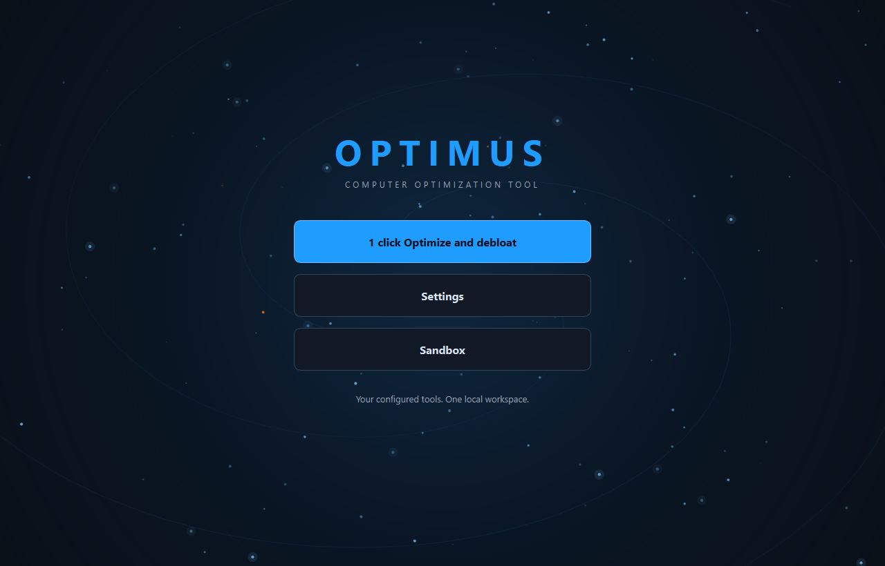

# Optimus: Computer optimization tool

Give your computer a clearer, cleaner workspace with Optimus: cleanup, browser privacy, process analysis and supported updates in one open-source app. Choose what it can do, run your saved maintenance with one click, and inspect or edit the source whenever you like. Native Windows, macOS and Linux downloads come without a subscription.

| Your computer | One-click download |
| --- | --- |
| Windows 10/11, Intel/AMD 64-bit | [Download for Windows](https://github.com/Ag3nt47/Optimus/releases/latest/download/Optimus-Windows-x64.zip) |
| macOS, Apple Silicon (M-series) | [Download for Mac — Apple Silicon](https://github.com/Ag3nt47/Optimus/releases/latest/download/Optimus-macOS-arm64.zip) |
| macOS, Intel | [Download for Mac — Intel](https://github.com/Ag3nt47/Optimus/releases/latest/download/Optimus-macOS-x64.zip) |
| Linux, Intel/AMD 64-bit | [Download for Linux](https://github.com/Ag3nt47/Optimus/releases/latest/download/Optimus-Linux-x86_64.tar.gz) |
| Editable source, every platform | [Download source](https://github.com/Ag3nt47/Optimus/releases/latest/download/Optimus-Source.zip) |

[Release notes and SHA256 checksums](https://github.com/Ag3nt47/Optimus/releases/latest) · [Platform capabilities and installation](docs/PLATFORMS.md)



Optimus combines previewed cleanup, browser privacy tools, resource management, startup controls, debloat actions, disk analysis, duplicate finding and updates in one local application. Its dark blue/orange presentation and reveal animations are adapted from the MIT-licensed [AngeronaSuite](https://github.com/Ag3nt47/AngeronaSuite).

## Cleaning, performance and privacy first

- **Review before Auto Clean.** Normal launches show saved app removals, files and browser records. Choose **Auto Clean** or the default **Adjust settings**. The optional **Auto clean with these settings** choice approves unattended sign-in/launch cleanup for that exact saved scope instead.
- **Reduce everyday background overhead.** Inspect measured process CPU/RAM/I/O, tune approved startup entries, clean selected junk/browser categories and use supported power and SSD/HDD maintenance.
- **Opt in to ongoing cleaning.** Smart Cleaning uses a configurable threshold (500 MB initially), browser-exit cleanup uses saved privacy choices, and daily/weekly/monthly cadence runs while the app is open. Opera is off by default.
- **Choose retained-data cleanup individually.** Archived Codex conversations, inactive Angerona logs and incomplete download fragments have separate default-off choices and independent age limits. Archived conversations are personal history; deleting them has no automatic undo. Full mode and general Cleanup Select all do not opt you into these scopes.
- **Watch free disk space.** A read-only before/after check warns when supported drives fall below the selected 1–2 GiB target, initially 2 GiB. Results retain each drive's observed free space, target and shortfall. This check does not allocate an exclusive reserve or authorize extra deletion.
- **Keep decisions and outcomes visible.** Scoped app/driver updates, separate worker status cards, cooperative stopping and verified recovery tools retain failures and unknown outcomes.
- **Control individual worker items.** Back reviews previous results. Next requests a skip of the live item; Cancel affects that item. Active installers finish and save their actual outcome before another item starts. Retry skipped work through a fresh reviewed run.
- **Set persistent app choices.** In Updates, choose Follow global settings, Always update or Always ignore updates, alongside Keep current state, Keep installed or Keep uninstalled. Exact saved rules are opt-in; supported Windows WinGet presence rules reinstall missing apps or remove returning apps during maintenance.

See **[all removal, cleanup and privacy options](docs/REMOVAL_OPTIONS.md)** before choosing debloat. Microsoft 365 consumer apps, Outlook and Edge have separate controls; Bing Wallpaper remains protected. Windows privacy and reinstall controls have explicit build/edition limits. Extra file tools and recovery live in Settings; irreversible overwriting is never part of Auto Clean.

**Unattended mode is off by default.** Enable it in initial setup or Settings to launch at sign-in and clean/update without Optimus questions. Save whether open browsers are skipped (default) or requested to close gracefully. Windows administrator consent and operating-system/vendor requirements remain in effect; interactive/unsupported work is left in results. Manual recommendations remain visible without opening questions. Changed scopes invalidate the saved approval until reviewed and saved again. No automatic reboot or forced browser termination is requested.

## Download and run

Version **0.11.11** improves worker-card text fitting, aligned rows and font-aware resizing. Each applicable card shows confirmed file bytes removed, completed installs and observed download sizes, retained through completion or cancellation without double-counting. Downloaded package bytes are separate from installed disk space. Windows app progress uses a hidden console connection because current WinGet suppresses progress when output is redirected to a pipe. Mixed native units such as KB downloaded out of a GB total are supported. Download and installation percentages reset independently; vendor installers that publish no percentage remain explicitly indeterminate.

Optional retention cleanup is configured in initial setup or Settings: each deletion scope starts off with a **7-day** age limit, adjustable independently from **1 to 3650 days**. Codex archive cleanup requires the supported official Codex CLI and verified archived state; active/unarchived conversations stay protected. Angerona retention covers only verified inactive Windows log locations. Download cleanup covers only eligible top-level `.crdownload`, `.part` and `.partial` fragments in the verified Downloads folder; old paused fragments are also discarded when this option is enabled. Completed downloads and active or unknown download state remain protected. The separate **drive-space check starts on**, reports warnings with a native warning icon and readable text, and never creates a reserve file, moves user files or promises enough space for every installer. [Scope and limitations](docs/APP_POLICIES.md#optional-retention-cleanup-and-drive-space-warnings).

Version **0.11.10** adds measured current-step progress for cleanup file checks, privacy controls and the record-processing phases of driver discovery. Native catalog searches without a progress API stay explicitly indeterminate. Known unsupported Windows privacy policies are marked **Not applicable** instead of repeated failed writes. Per-item installer completion receipts distinguish a finished package from a stale batch header, preserving failed/unknown outcomes and exact offer holds while other eligible work continues.

Version **0.11.9** separates each worker's **Overall** completion from its current-item ring. The ring shows the reported download, installation or operation percentage and resets for the next package or phase. Windows Update and supported WinGet output provide native progress where available; opaque installers remain indeterminate. CPU use and queue counts never substitute for an individual operation percentage.

Version **0.11.7** checks GitHub for a newer stable Optimus release before normal startup maintenance. On supported Windows installations, **Yes — update then Auto Clean** downloads and verifies the release first, preserves saved choices, and performs a guarded restart before that unchanged approved cleanup. No or an unavailable check continues normal launch review. See [startup updates](docs/SELF_UPDATE.md) for verification, consent and platform limits.

Version **0.11.7** also adds automatic recovery for verified Windows inbox driver backups, stable Unity editor versions and WinGet's numeric installed-version upper bounds. Held publisher offers receive bounded automatic source/metadata rechecks on later approved runs; a bad or mismatched installer is never retried on metadata alone. Driver offer counts stay separate from backup prerequisite findings, including saved reports. Saved approvals, exclusions, signatures and unknown-installer guards remain in effect. The packaged updater includes a pinned Mozilla CA bundle alongside native trust roots, with an offline packaged TLS check; HTTPS certificate and hostname verification remain required.

Version **0.11.5** gives every security finding one labeled **Review** checkbox that adapts to theme/font changes; selecting it never replaces the separate Yes/No approval. Independent maintenance uses slow catalog-search time and continues while a prior installer blocks cleanup, slowdown analysis supports cooperative cancellation, and follow-up previews explain blocked update channels instead of offering attempts that cannot run. Known package-specific refusals are skipped while eligible work continues; unresolved installers, shared update failures and required restarts remain visible.

Version **0.11.2** skips held or unavailable individual app offers and continues the remaining eligible app queue. Finished app workers distinguish skipped items from a blocked installer, retain incomplete-search warnings, and show which active app or driver worker maintenance is waiting for. Exact-version holds, source/pin checks and unknown-installer barriers remain in effect.

Version **0.11.1** adds per-worker Back/Next/Cancel controls and persistent per-app update and installation-state rules. [App policies and worker controls](docs/APP_POLICIES.md) explain scope, supported installers, cancellation and recovery. The Software Updater master switch controls these saved rules; no application rule is selected by default. Native macOS/Linux update rules use their supported package managers; automatic install/uninstall presence rules currently require Windows WinGet.

Worker rings show reported progress for the current item and phase, resetting for each package or operation. A `~` prefix marks approximate download progress from the updater's native downloaded/total counters; opaque installer steps stay indeterminate. Overall stage/queue progress and computer CPU/RAM/clock and passive network rates remain separate. Targeted driver backups avoid exporting the whole driver store. Known item failures advance with saved results; shared safety conditions and uncertain installer outcomes defer further conflicting changes while independent checks continue.

Version **0.10.1** adds the launch warning, default-off Smart Cleaning/browser-exit cleaning, calendar-month scheduling, opt-in Opera support, privacy controls, verified driver/System Restore recovery, authenticated file utilities and a red Revert control. Intel Mac builds compile the current cryptography dependency with isolated static OpenSSL to avoid a packaged-library conflict. Additional worker cards fit within the existing windows. [Detailed scope and removal options](docs/REMOVAL_OPTIONS.md) document defaults and limitations. The launch review supersedes the unattended startup behavior described in older release notes below.

Version **0.9.9** lets approved Windows Update drivers attempt a verified quiet installation even when their metadata allows user input. Quiet mode and suppressed source prompts must be established before download or installation; unsupported quiet handlers remain for review. It also adds cooperative safe stopping: Close requests cancellation, waits for active work and preserves final receipts before exit. Cancel keeps the results window open. A local safe-stop command requests the same behavior without killing installers.

Version **0.9.8** keeps read-only app and driver discovery available when an earlier installer needs review. Searches retain their offer counts while new installations and conflicting cleanup remain blocked. Worker cards distinguish a search that never started, a completed search and an installation block. Exact-version automatic update holds can skip a reviewed problem package while other approved apps continue; manual update choices remain separate.

Version **0.9.6** records what each update search actually checked. Driver discovery explicitly queries the configured Windows Update service online and retains its result code, timing, applicable offers and present-device coverage. App discovery reports offered, recognized and approved candidates separately from installer outcomes. Worker cards and saved journals distinguish a successful zero-offer search from partial, failed or deferred checks. A failed search with a known no-installer outcome leaves the independent update channel available; unresolved installer outcomes remain guarded. Unsupported version text stays marked for review; neither a successful installer nor an empty parsed list establishes that every app or driver is current. Windows Update does not cover every OEM catalog, and WinGet does not cover every installed app.

Version **0.9.4** keeps each update worker's elapsed time through discovery, waiting and completion, and shows the concrete reason for a known pre-install refusal. The progress raccoon is twice as wide. Content windows resize to the available desktop and retain the size you choose during the session. Cancel and Auto continue remain visible while detailed content scrolls; the Sandbox toolbar wraps as its window narrows.

Version **0.9.2** keeps deferred-worker messages readable at smaller window sizes and groups repeated installer warnings once. It also adds [audited recovery for a proven legacy update preflight error](docs/UPDATE_RECOVERY.md), preserving the original records and successful installation receipts. Unknown installer outcomes remain blocked; recovery never launches an installer.

Version **0.9.1** starts **Maintenance**, **App updates** and **Driver updates** together on Windows when background updates are enabled. App and driver discovery run in their own workers alongside the initial resource check. Shared temporary-file cleanup waits for discovery; approved installers then share an exclusive slot while independent maintenance continues. Each panel shows its actual scanning, preparation, installation or waiting state. Final verification waits for both update receipts. Native macOS/Linux app discovery also overlaps the initial audit; hardware support remains a read-only native capability. Exact saved approvals, version pairs, cancellation and unresolved-installer protections remain enforced.

Windows can give the interface Above Normal CPU priority, with normal base priority for bulk workers and a saved next-launch toggle. No Real-time or RAM allocation boost is requested.

A dancing raccoon with a cane keeps the loading screen company. Its [Tenor GIF and poster](src/optimus/assets/RACCOON-NOTICE.txt) are bundled locally as separate third-party assets; playback pauses while hidden or minimized and honors reduced motion.

Version **0.8.1** fixes the apparent pause after privacy controls during a long application update. Selected temp/browser cleanup finishes before the updater starts, then safe startup, duplicate, cloud and driver metadata reviews continue beside it. Conflicting maintenance and final verification still wait, with a dedicated waiting display showing the actual package, processed count and elapsed time. Saved choices remain unchanged.

Version **0.8.0** adds an automatic **Speed enhancements** package with native power-policy checks, fresh configuration verification and recorded undo. Full mode enables it; existing choices stay editable in Settings. Advanced Windows options add WinGet's non-security compatibility mode and a legacy unsupported-CPU policy for eligible media-Setup cases. The separate Windows-media script scans the selected image before an explicitly requested upgrade. See [Speed enhancements and compatibility](docs/SPEED_ENHANCEMENTS.md) for scope, script commands and limits.

The one-click workflow also offers eligible Windows SSD TRIM/HDD optimization, a saved automatic post-scan continuation choice, and background app updates while independent work continues. The critical-review bot checks fixture UI layouts and workflow behavior during native builds, publishing a report and screenshots. [One-click coverage](docs/ONE_CLICK_COVERAGE.md) explains which actions can be automatic and which still need an explicit scope or decision.

Version **0.7.2** adds **Auto continue — apply available fixes** to completed scan/cleanup results. Review the listed automatic fixes, then click once to apply them as a batch and verify the outcomes. It can apply supported Windows security corrections and retry remaining updates within your saved scopes and licence approvals. Restarts, vendor-only patches and newly suggested program changes stay listed for manual action. Auto continue does not repeat cleanup or debloat, and closing results never approves a fix.

Choose your native download above; Python is not required. **Windows:** extract the entire ZIP and open `Optimus.exe`, keeping `_internal` and `source` beside it. **macOS:** extract the ZIP, move `Optimus.app` to Applications, and open it. **Linux:** extract the tar archive and run `Optimus/Optimus`; keep its supporting files together. The macOS builds are ad-hoc signed, without Apple notarization; use the normal macOS Privacy & Security review if Gatekeeper asks. Do not disable operating-system protections.

Version **0.7.1** gives confirmation prompts larger, clearly labelled Yes/No buttons and removes the floating globe. Minimize now uses the taskbar or Dock, and closing the main window exits after active work and unsaved Sandbox edits are resolved. Reopening Optimus brings its existing question or progress window forward instead of starting a second cleanup. The starfield background and other window transitions remain available.

Version **0.7.0** introduces native macOS and Linux backends and a four-platform build/test matrix. Shared cleanup, supported browser profiles, resource analysis, disk/duplicate tools, Sandbox and native startup/package-manager operations use the host platform. Windows registry, Appx debloat, Defender, DPAPI/OneDrive integration, Windows Update drivers and Windows-specific repair tools remain Windows features; unavailable actions are identified instead of emulated. See [the capability table](docs/PLATFORMS.md) for exact scopes and requirements.

Start normally. Windows can request administrator permission once on startup. On macOS and Linux, privileged changes remain subject to the platform's authentication and package-manager rules. The Windows build is unsigned; the macOS builds have no Developer ID signing or notarization. CI validates macOS 14 Apple Silicon, macOS 15 Intel and Ubuntu 22.04 x86_64; other compatible desktops need local verification.

**Version 0.6.2** adds automatic before/after resource observations and a comparison with the previous complete inventory of enabled Run/Startup-folder entries. Results show measured CPU, available RAM and disk free space separately from verified cleanup totals; they do not claim that Optimus caused every difference. Incomplete inventories do not replace the startup baseline. Redirected TEMP and the original LocalAppData temporary folder are separate selectable cleanup categories; choosing Full includes both available locations, while existing saved category selections stay unchanged. Settings can check the effective Windows sign-in task and apply/repair its saved choice. `--startup-probe` checks GUI startup without requesting elevation, starting maintenance or resuming background sampling. The Sandbox also retains PowerShell module files when editing and exporting source.

For **automatic launch and one-click cleanup**, enable **Launch Optimus when I sign in to Windows**, **Request administrator permission on startup**, and maintenance **Each Optimus startup** in Settings/setup. Save the choices first. The normal Windows consent prompt requires Yes; declining retains standard access with protected actions deferred. Open browsers retain their individual close-or-skip prompts. See the [CCleaner/GitHub comparison and enhancement roadmap](docs/COMPARISON-2026-10.md) for documented competitor functions and remaining opportunities.

**Version 0.6.1** makes **Full Optimization** the new-install default. After first-start choices are saved it runs once whenever Optimus opens, until you change the mode or cadence. Full includes eligible temporary files at age 0, browser cleanup with close-or-skip prompts, the selected consumer-app removal list, supported update checks, Windows advertising/optional diagnostics preferences, a Defender quick scan, and final security/process recommendations. Startup can request administrator permission once; Windows still requires the UAC Yes click. Scans and smoke tests never request elevation or apply maintenance.

The workflow finishes with a bounded, read-only verification of recorded outcomes before presenting recommendations. It distinguishes confirmed effects, items needing review, unavailable evidence and operations that made no changes. Review the verification summary, then continue to the security and background-program choices. A completed worker operation alone is not proof that its requested effect occurred.

Software updates require a provably newer offered version; equal, older, equivalent and incomparable versions are skipped. Automatic app/driver/Windows Security/Critical update installation retains separate saved scopes and agreement acceptance. No feature upgrade or reboot is automatically requested. Vendor-only and legacy/community patch reports show source, applicability and licensing gaps; they do not install arbitrary unofficial drivers or promise support where no compatible patch exists.

**Version 0.5.0** adds **Select all / Clear all** to multi-choice setup groups, browser history/cookie/download-list options with per-browser **close and clean / skip** prompts, and a process cleanup harness with explicit, reversible selected actions. Existing saved settings do not enable the new privacy options. The reporting fixes from 0.4.1 remain included.

**Version 0.4.0** expands the driver updater with coverage for present hardware and future device approvals even when no update is currently offered. Software Updater can install selected applications or all supported WinGet applications with a separate saved approval and exclusions. Junk Clean adds optional diagnostics and graphics-cache categories. Performance measures application CPU, RAM and I/O across multiple samples and explains potential slowdown contributors. Existing duplicate, OneDrive and startup approvals and Bing Wallpaper protection are retained.

## Main controls

- **1 click Optimize and debloat** runs the modules selected in Settings. A live window shows actual completed-stage percentages, the current operation, process information and a detailed activity log. Cancellation stops at a safe boundary.
- **Settings** contains Low/Standard/High cleanup presets, individual removal choices, priority/affinity controls, optional background analysis, the full maintenance tools and appearance settings.
- **Sandbox** opens an editable working copy of the full source. Save, version history, Revert and Original version are available. **Restart Optimus** validates the saved Python source and starts that version; the current app remains open if the new interface does not report ready.
- **Revert** opens recorded changes and supported recovery choices. Review selected changes or all available undo actions before applying. Permanent deletions and actions without a supported recovery path remain clearly marked.


New installations start in Full Optimization. Setup displays the concrete selected consumer packages and browser categories before saving. Bing Wallpaper remains protected. Existing configurations keep their saved individual choices; choosing Full applies its preset once, and later changes are retained. Existing Codex priority watchers are left unchanged. If you previously enabled background analysis in the saved configuration, it resumes at that saved interval when the interface reopens. Scheduled/command-line audits do not start background analysis.

## First-start questions and automatic maintenance


The setup opens on the first normal GUI launch. It covers Health Check, Custom Clean, Uninstaller/debloat, Duplicate Finder, personal OneDrive review, Performance Optimizer, Startup Manager, Software Updater and Driver Updater. Cancel keeps your existing settings. **Save choices** stores the reviewed selections; **Run selected maintenance now** is a separate opt-in. Rerun the questions from Settings at any time.

Use **Select all** or **Clear all** for cleanup, debloat and performance options, or for the eligible entries in loaded startup, software and driver lists. Load an inventory first; software selection uses Selected mode, and hardware selection uses matching-device mode. The buttons do not accept agreements, grant automatic-change consent, change cadence or start maintenance. Changes to selected entries clear the related consent so you can review the new scope before saving. Existing 100-entry approval limits and the 2048 unique hardware-rule limit remain in effect; excess entries stay unchecked and the status explains why.

Custom Clean includes separate choices for caches, browsing history, cookies/site sign-ins and Chromium download-list records. Select which supported browsers to include and any cookie domains to keep. Each open browser gets its own Yes/No prompt during maintenance: **Yes** requests a normal close and cleans the selected data once every process exits; **No** skips that browser for this run. Optimus never force-kills a browser. History/cookie cleanup uses private database backups and excludes passwords, bookmarks and downloaded files; those backups retain the original records and are not secure erasure.

In **Settings → Performance → Process cleanup harness**, scan all process inventory rows and inspect measured resource use, parent/launch evidence, program ownership and protection reasons. Choose exact eligible actions, then **Clean up selected**. Supported harness actions pause a verified process or disable a freshly revalidated startup registration; they do not delete programs or guess that an old/high-memory process is unnecessary. Resume paused apps and supported startup History provide recovery. A read-only `--process-scan --output <folder>` harness export is available for local analysis, including Codex.

The command-line `--output <folder>` option selects the report destination for read-only audits, process scans and saved-run verification.

Choose manual operation, each Optimus startup, daily while Optimus is open, or weekly while Optimus is open. Daily/weekly timing is measured from the last attempt, including failures, to avoid repeated installer attempts. These modes do not install a background Windows service or run when Optimus is closed. The existing Task Scheduler feature remains a separate read-only audit.

Your selected cleanup, curated removals and Codex priority profile can apply automatically. Software Updater offers review, selected exact WinGet IDs, or all supported installed WinGet applications. All-supported mode needs its own explicit saved approval; excluded IDs remain unchanged. Each apply uses a fresh recognized source-checked scan and verified package identity. Pinned, ambiguous, unknown-version and unsupported applications are skipped. Package/source agreements require consent. Vendor installers may require administrator permission or close applications; Optimus does not request automatic reboots.

Duplicate, cloud, startup and driver modules each offer review mode or a saved apply approval. Local recycling uses your chosen folders, oldest/newest keeper, minimum age and per-run count limit; a retained copy is revalidated before each recycle. Personal OneDrive recycling is bound to the verified drive and concrete folders you approve. It additionally streams candidate contents for SHA256 comparison, limited to 64 MiB per file and 256 MiB per run; unsupported or oversized comparisons are skipped. Files go to the corresponding Recycle Bin; the bins are not emptied.

Startup automation disables only the exact registrations you selected, with their saved command/location/fingerprint still matching; it keeps recovery records. Driver automation can install exact approved update IDs/revisions or future Windows Update drivers matching the approved hardware ID, provider, class and date floor. Load present hardware in matching mode to approve eligible devices even when no update is currently offered. Hardware coverage distinguishes available offers, device problems, incomplete scans and no offer; no offer does not establish that the installed driver is the newest available from the manufacturer. Compatible hardware IDs can identify multiple devices of the same model. Quiet installation requires an already elevated Optimus session, current metadata and a successful driver export first. Pending-reboot, unknown-behavior, changed or unverified candidates are skipped. Updates with known potential input are attempted only after quiet mode and suppressed source prompts are verified. Drivers that cannot support [Windows quiet installation](https://learn.microsoft.com/en-us/windows/win32/api/wuapi/nf-wuapi-iupdateinstaller2-get_forcequiet) remain for review. No automatic reboot is requested.

Each approval is optional and can be revoked by turning its module off or choosing review mode in setup. Revocation stops future changes; it does not restore items already recycled, disabled or installed. Use the Recycle Bin, History/startup restoration, Windows driver rollback or saved driver exports as applicable. Arbitrary app uninstalls and service changes still use their individual tools. Cloud connection is an explicit account action; cancelling the maintenance questions does not undo a connection you initiated.

The completion window records actual per-stage results, exclusions and failures. Pause automatic maintenance by choosing **Manual** in setup. Background resource sampling has its own saved On/Off choice.

## Tools

- System health and measured application-family CPU/memory/I/O reports with explanations and links to process controls.
- Optional background CPU, memory, disk-I/O and network measurements, with an Off/On control.
- Individual application priority, CPU affinity, recoverable sleep/wake and allocation history.
- Junk Clean with allowlisted temporary/cache files, optional user/system error reports, crash dumps and graphics caches; per-file identity checks, age limits and local logs.
- Chromium/Firefox privacy previews and private SQLite backups; passwords and bookmarks are preserved.
- Startup entry enable/disable/delete with backed-up restoration; third-party service controls.
- Installed applications and registered Windows uninstall access.
- Selected or explicitly approved all-supported software updates through WinGet, pin protection and exclusions; all-present hardware coverage and Windows Update driver tools.
- Bounded disk scans, SHA256 duplicate finding and confirmed single-file recycling.
- Selective stale HKCU App Paths review with backed-up removal and conflict-checked restoration.
- Optional personal OneDrive metadata duplicate review, using your own Microsoft app registration and a DPAPI-protected local sign-in.
- Curated consumer-app, Microsoft 365, Outlook and Edge removal plans. Bing Wallpaper, Store, security components, frameworks and WebView2 are preserved by the curated debloat actions.
- Optional integration with an existing Desktop `Specialized Computer Management/Remove-Edge.ps1`: preview and exact script-hash verification, followed by its own visible administrator/typed-confirmation flow.
- Read-only scheduled reports, local history and supported setting restoration.

See [the user guide](docs/USER_GUIDE.md) and [feature coverage](docs/FEATURES.md) for operation-specific behavior. Optimus is an independent implementation, not a patched CCleaner executable or a claim of identical vendor catalogs, cloud integrations or native algorithms.

## Standalone Angerona cleanup

The MIT-licensed [Angerona Disposable Cleanup](tools/angerona-cleanup/README.txt) is maintained in [tools/angerona-cleanup](tools/angerona-cleanup) with native Windows PowerShell 5.1 tests. Its [independent 1.1.0 release](https://github.com/Ag3nt47/Optimus/releases/tag/angerona-cleanup-v1.1.0) provides the standalone source archive. See its README for installation, Windows consent prompts, cleanup scopes and recovery limits.

To stop the running app safely, use `Optimus.exe --safe-stop`, or run the packaged `source\scripts\Safe-Stop-Optimus.ps1`. Source checkouts pass the installed path with `-Executable`. Exit code 0 acknowledges the stop request; it does not mean every operation has already finished. Active operations are allowed to return and save their outcomes. Unknown native outcomes remain recorded and block retries.

## Build from source

On macOS or Linux:

```sh
python3 -m venv .venv
. .venv/bin/activate
python tools/install_build_dependencies.py
python -m pip install -e . --no-deps
python tools/test_native.py
python -m optimus
```

Build on the operating system and CPU architecture you intend to distribute:

```sh
python tools/build_native.py
```

This produces the native application under `dist`, includes the editable public source and dependency licenses, runs read-only packaged checks, and writes its platform archive to `release-assets`. The macOS archive preserves application/framework symlinks; the Linux tar archive preserves executable permissions. Linux builds target glibc 2.35 or newer and require desktop graphics libraries. See [the build and platform notes](docs/PLATFORMS.md).

Install Python 3.12, then run:

```powershell
python -m venv .venv
.\.venv\Scripts\python.exe -m pip install -e ".[build,test]"
.\.venv\Scripts\python.exe -m pytest -q
.\.venv\Scripts\python.exe -m optimus
```

`Install-Source.bat`, `Start-Optimus.bat` and `Build-Windows.bat` provide the same basic workflow. Exact dependency versions used for the release build are in `requirements-build.txt`.

To build the portable executable:

```powershell
.\.venv\Scripts\python.exe -m PyInstaller --noconfirm --clean --windowed --onedir --name Optimus --icon src/optimus/assets/optimus.ico --paths src --collect-all optimus --collect-submodules psutil --add-data "LICENSE;." --add-data "NOTICE;." launch.py
.\.venv\Scripts\python.exe tools/normalize_bundle.py --bundle dist/Optimus
.\.venv\Scripts\python.exe tools/package_source.py --source . --destination dist/Optimus/source
.\.venv\Scripts\python.exe tools/package_licenses.py --source . --destination dist/Optimus
```

The build normalization step checks Qt's required Windows ICU symbols and removes only a recognized conflicting ICU library collected from the build PATH. It refuses unknown dependencies and never changes Windows system files.

The `source` folder is required for the Sandbox editor. Saved source executes with the current Windows account's permissions after an explicit restart; the editor is a source workspace, not an operating-system isolation boundary.

## Data and recovery

macOS stores its local state under `~/Library/Application Support/Optimus`. Linux uses `$XDG_STATE_HOME/optimus`, defaulting to `~/.local/state/optimus`. macOS source and license payloads are contained within `Optimus.app/Contents/Resources`. The following relocation example uses Windows paths; a native relocation target must be an ordinary absolute path on that platform.

User settings, reports, operation journals, browser rollback copies and source history use `%LOCALAPPDATA%\Optimus` by default. A relocated installation can place `Optimus.location.json` beside `Optimus.exe`, with exactly `{"schema":1,"data_dir":"D:\\OptimusData"}`. The target must be an ordinary absolute local folder. Invalid, indirect or oversized configuration is rejected; it never silently falls back to another folder. Sandbox restarts use the original installation location too. Machine-specific location files are excluded from public downloads. They are not uploaded by Optimus. Cleanup permanently deletes the previewed cache files; duplicate removal uses the Recycle Bin. Application uninstalls and all debloat operations are not universally reversible. Each removal plan describes its recovery route.

No runtime reports, browser databases, machine inventories, credentials or proprietary CCleaner files are included in this repository. Network access is used by explicitly requested update and cloud operations.

## License

MIT for Optimus and the adapted Angerona presentation code. See [LICENSE](LICENSE) and [NOTICE](NOTICE) for third-party licenses. PySide6/Qt retain their own licenses.


