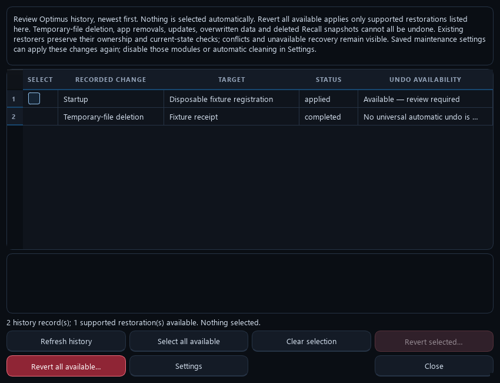
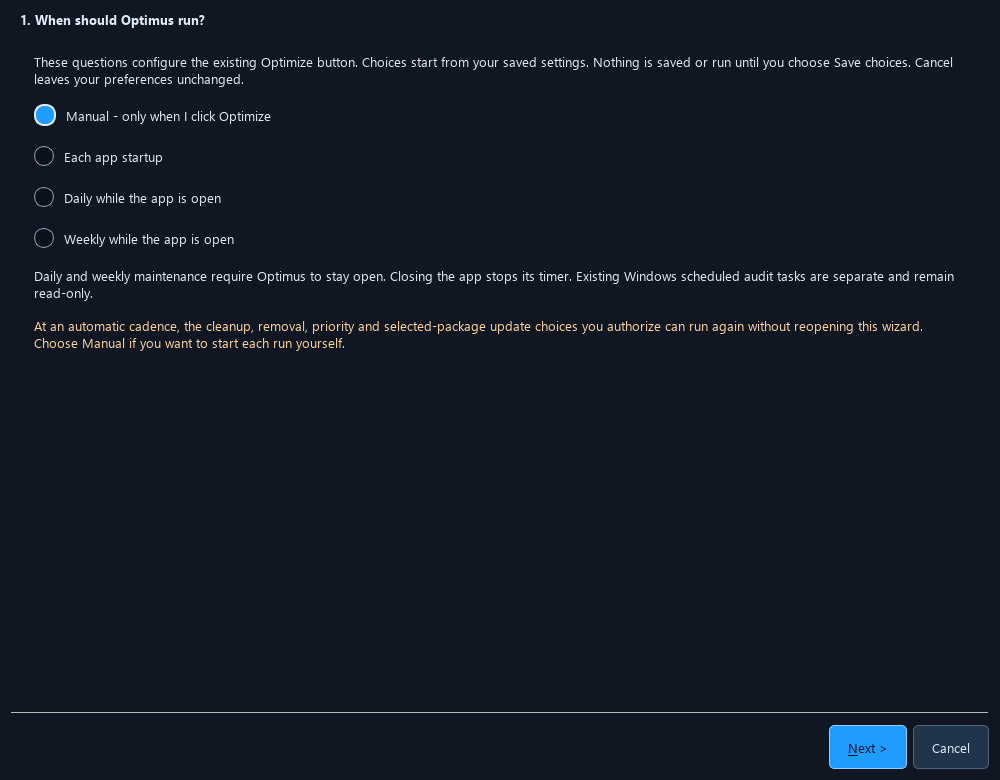

# Optimus: Computer optimization tool

**Cleanup, privacy, updates and troubleshooting in one free, open-source desktop app.** Optimus puts local maintenance under your control on Windows, macOS and Linux: choose the scope, run your saved choices with one click, and inspect the results, without a subscription.

[See the demos](#see-optimus-in-action) · [Capabilities](#what-optimus-can-do) · [Get started](#download-and-run) · [User guide](docs/USER_GUIDE.md) · [Full feature matrix](docs/FEATURES.md)

| Your computer | One-click download |
| --- | --- |
| Windows 10/11, Intel/AMD 64-bit | [Download for Windows](https://github.com/Ag3nt47/Optimus/releases/latest/download/Optimus-Windows-x64.zip)<br><sub>63.96 MiB compressed</sub> |
| macOS, Apple Silicon (M-series) | [Download for Mac — Apple Silicon](https://github.com/Ag3nt47/Optimus/releases/latest/download/Optimus-macOS-arm64.zip)<br><sub>47.28 MiB compressed</sub> |
| macOS, Intel | [Download for Mac — Intel](https://github.com/Ag3nt47/Optimus/releases/latest/download/Optimus-macOS-x64.zip)<br><sub>51.49 MiB compressed</sub> |
| Linux, Intel/AMD 64-bit | [Download for Linux](https://github.com/Ag3nt47/Optimus/releases/latest/download/Optimus-Linux-x86_64.tar.gz)<br><sub>91.53 MiB compressed</sub> |
| Editable source, every platform | [Download source](https://github.com/Ag3nt47/Optimus/releases/latest/download/Optimus-Source.zip)<br><sub>4.67 MiB compressed</sub> |

Download sizes shown are for **v0.12.9**.

[Release notes and SHA256 checksums](https://github.com/Ag3nt47/Optimus/releases/latest) · [Platform capabilities and installation](docs/PLATFORMS.md)

## See Optimus in action


These demos show the actual Qt interface with sample data. No host maintenance runs during capture.

[](docs/media/optimus-walkthrough.mp4)

[Watch/download the MP4 walkthrough](docs/media/optimus-walkthrough.mp4) · [Full screenshot gallery and capture details](docs/DEMOS.md)

## What Optimus can do

- **Cleanup:** Preview selected temporary files, diagnostics and rebuildable app caches with age limits and local logs.
- **Browsers:** Clean supported cache, history, cookies and download lists; preserve passwords, bookmarks and chosen cookie domains.
- **Windows privacy/debloat:** Choose supported privacy settings and curated removals, including separate Microsoft 365, Outlook and Edge controls.
- **Updates:** Manage supported app offers, package rules and Windows Update drivers with scoped approval and backup checks.
- **Security:** Run Defender quick scans and review threats, supported corrections and eligible Windows Security/Critical updates.
- **Processes/startup:** Inspect CPU/RAM/I/O and ownership; control eligible priorities, affinity, pause/resume, startup entries and Windows services.
- **Storage:** Find large files, track folder growth, verify SHA256 duplicates and optimize eligible Windows SSDs/HDDs.
- **Cloud:** Review personal OneDrive duplicates on Windows with your own connected account and approved folders.
- **Automation:** Schedule maintenance while open; add Smart Cleaning, browser-exit, low-space, workload and retention options.
- **Recovery:** Inspect verified outcomes, supported undo, browser backups, driver rollback and Windows restore-point tools.
- **Advanced tools:** Use local diagnostics, encryption, split/join, selective registry repair, compatibility tools and command-line reports.
- **Sandbox/platforms:** Edit source with history/restart, choose themes, check self-updates and use native Windows/macOS/Linux builds.

<details>
<summary>Detailed capabilities, provider coverage and platform limits</summary>

- **Clean clutter and browser data.** Preview selected temporary files, error reports, crash dumps and graphics caches. Clean supported Chromium/Firefox cache, history, cookies and download-list records, with cookie exceptions and close-or-skip choices. Optional Discord, Spotify, Steam and Teams web-cache recipes have separate limits. Passwords, bookmarks and downloaded files are excluded. [Cleanup and privacy choices](docs/REMOVAL_OPTIONS.md)
- **Choose Windows privacy and debloat actions.** Review supported advertising, optional diagnostics, suggestions and reinstall controls; select curated consumer apps, Microsoft 365 consumer packages, Outlook and eligible Edge removal separately. Desktop Office and arbitrary desktop-app removal use reviewed native uninstall routes. Build, edition and management limits apply. [Exact targets and irreversible effects](docs/REMOVAL_OPTIONS.md)
- **Maintain supported apps and drivers.** Review or approve exact/all-supported WinGet app offers, per-app update rules and Windows-only Keep installed/Keep uninstalled rules. Windows Update driver offers need matching approval, backup and quiet-install checks. Homebrew, apt and dnf cover supported native packages; pacman stays review-only. Existing Chocolatey is optional with separate ownership limits. [App policies](docs/APP_POLICIES.md) · [Additional updater](docs/additional-package-updates.md)
- **Review security with native tools.** Run Windows Defender quick scans for viruses, malware and spyware; review current threats before requesting removal. Supported Defender/firewall corrections and Windows Security/Critical updates retain their own approvals. OEM/vendor-only and legacy/community patch routes provide source information for review. [Scan and threat review](docs/antimalware-scan.md) · [Automatic/manual boundaries](docs/ONE_CLICK_COVERAGE.md)
- **Understand background work.** Inspect measured process CPU/RAM/I/O, ownership and startup evidence; choose eligible priority, affinity, pause/resume and startup actions. Windows adds protected third-party service controls, read-only task inventory, Task Scheduler access and read-only audit schedules. The tray context menu opens or quits Optimus; Explorer shell-extension management is unavailable. [Process and system tools](docs/USER_GUIDE.md)
- **Explore storage and duplicates.** Find large files and folder growth, compare local duplicates with SHA256, and recycle selected extras after verifying a retained copy. Eligible Windows internal drives can use native SSD TRIM/HDD optimization. Windows personal OneDrive review/recycling needs your own app registration, account connection and scoped approval. [Storage/retention](docs/cleanup-storage-toolkit.md) · [Platform matrix](docs/PLATFORMS.md)
- **Automate approved choices.** Use launch, daily, weekly or calendar-month cadence; optional Smart Cleaning, browser-exit cleanup and low-space cleanup run while Optimus is open. Add supported workload, idle, power, full-screen, network-cost and time-window conditions. Codex archive, inactive Angerona log and incomplete-download retention are separate opt-ins. [Maintenance toolkit](docs/maintenance-toolkit.md) · [Retention choices](docs/APP_POLICIES.md#optional-retention-cleanup-and-drive-space-warnings)
- **See outcomes and recovery.** Separate worker cards retain progress, failures, skips and unknown outcomes. Back/Next/Cancel controls stop at supported boundaries. Recorded changes offer supported undo, browser rollback copies, driver recovery or native restore routes. Eligible installer-payload cleanup tracks successful disposable downloads. [Worker controls](docs/worker-layout-and-skip.md) · [Recovery/file tools](docs/REMOVAL_OPTIONS.md#recovery-and-file-tools) · [Payload cleanup](docs/update-payload-cleanup.md)
- **Reach for advanced tools when needed.** Inspect resource history, available hardware/battery/boot/pagefile facts and installer headroom. Apply eligible native power preferences with recorded undo; request Windows DISM/SFC checks and separately approve repair. Use authenticated file encryption/decryption, checksummed split/join, separately reviewed file overwriting and narrow Windows current-user App Paths repair. CLI reports, update-only continuation, safe stopping and scoped compatibility tools are available. [Diagnostics](docs/performance-diagnostics.md) · [Power/compatibility](docs/SPEED_ENHANCEMENTS.md) · [Update continuation](docs/update-continuation.md)
- **Make the app yours.** Sandbox edits bundled source with validation, history, export, revert and a ready-checked restart. Choose themes and reduced motion. Stable GitHub release checks offer guarded automatic replacement on supported Windows installations and manual native downloads elsewhere. [Self-update scope](docs/SELF_UPDATE.md) · [Platforms and source](docs/PLATFORMS.md)

The [full feature matrix](docs/FEATURES.md) records implementation and recovery limits; the [comparison and roadmap](docs/COMPARISON-2026-10.md) separates current tools from remaining work. No update offer does not prove every app or driver is current. Privacy controls cannot stop all third-party tracking, and maintenance does not guarantee a speed gain. Third-party accounts, licences and services are not bundled.

| Shared native tools | Additional Windows integrations | Native platform limits |
| --- | --- | --- |
| Scoped cleanup, supported browser profiles, process analysis, disk/duplicate tools, file utilities, Sandbox and recorded recovery | Appx debloat, supported Windows privacy controls, WinGet presence rules, Windows Update drivers/security patches, Defender, driver backup/rollback, System Restore, selective registry review and personal OneDrive | macOS has no CPU-affinity control; Safari cleanup is unavailable. macOS/Linux do not implement automatic app-presence changes or Windows-specific tools. Cloud covers personal OneDrive on Windows only; business/shared drives, SharePoint, Google Drive and Dropbox are unsupported. See the [platform matrix](docs/PLATFORMS.md). |

</details>

The dark blue/orange presentation and reveal animations are adapted from MIT-licensed [AngeronaSuite](https://github.com/Ag3nt47/AngeronaSuite).

## Cleaning, performance and privacy first

- **Review before Auto Clean.** Normal launches show saved app removals, files and browser records. Choose **Auto Clean** or the default **Adjust settings**. The optional **Auto clean with these settings** choice approves unattended sign-in/launch cleanup for that exact saved scope instead.
- **Reduce everyday background overhead.** Inspect measured process CPU/RAM/I/O, tune approved startup entries, clean selected junk/browser categories and use supported power and SSD/HDD maintenance.
- **Opt in to ongoing cleaning.** Smart Cleaning uses a configurable threshold (500 MB initially), browser-exit cleanup uses saved privacy choices, and daily/weekly/monthly cadence runs while the app is open. Opera is off by default.
- **Choose retained-data cleanup individually.** Archived Codex conversations, inactive supported Windows Angerona logs and incomplete download fragments have separate default-off choices. Each starts at 7 days, adjustable independently from 1 to 3650 days. Archived conversations are personal history; deletion requires verified archived state through the supported official integration and has no automatic undo. Completed downloads and active/unknown fragments are preserved; old paused fragments can be discarded. Full mode and general Cleanup Select all do not opt you into these scopes.
- **Watch free disk space.** A read-only before/after check starts on and warns when supported drives fall below the selected 1–2 GiB target, initially 2 GiB. Results retain each drive's observed free space, target and shortfall. This check does not allocate an exclusive reserve or authorize extra deletion.
- **Keep decisions and outcomes visible.** Scoped app/driver updates, separate worker status cards, cooperative stopping and verified recovery tools retain failures and unknown outcomes.
- **Control individual worker items.** Back reviews previous results. Next requests a skip of the live item; Cancel affects that item. Active installers finish and save their actual outcome before another item starts. Retry skipped work through a fresh reviewed run.
- **Set persistent app choices.** In Updates, choose Follow global settings, Always update or Always ignore updates, alongside Keep current state, Keep installed or Keep uninstalled. Exact saved rules are opt-in; supported Windows WinGet presence rules reinstall missing apps or remove returning apps during maintenance.

See **[all removal, cleanup and privacy options](docs/REMOVAL_OPTIONS.md)** before choosing debloat. Microsoft 365 consumer apps, Outlook and Edge have separate controls; Bing Wallpaper remains protected. Windows privacy and reinstall controls have explicit build/edition limits. Extra file tools and recovery live in Settings; irreversible overwriting is never part of Auto Clean.

**Unattended mode is off by default.** Enable it in initial setup or Settings to launch at sign-in and clean/update without Optimus questions. Save whether open browsers are skipped (default) or requested to close gracefully. Windows administrator consent and operating-system/vendor requirements remain in effect; interactive/unsupported work is left in results. Manual recommendations remain visible without opening questions. Changed scopes invalidate the saved approval until reviewed and saved again. No automatic reboot or forced browser termination is requested.

## Download and run

Choose your native download above; Python is included. **Windows:** extract the entire ZIP and open `Optimus/Optimus.exe`, keeping `_internal` and `source` beside it. **macOS:** extract the ZIP, move `Optimus.app` to `/Applications` or `~/Applications`, and open it. **Linux:** extract the tar archive and run `./Optimus/Optimus`; keep supporting files together. Linux needs a graphical desktop, glibc 2.35 or newer and the listed Qt runtime libraries.

The Windows executable is currently unsigned. macOS builds are ad-hoc signed, without Developer ID signing or notarization; review a blocked first open through the normal Privacy & Security interface. Do not disable operating-system protections. Windows can request normal administrator consent; declining defers protected actions. Do not run the entire macOS/Linux GUI as root; package-manager authorization remains separate. [Installation requirements](docs/PLATFORMS.md#installation)

Review and save the first-start choices, then choose **Auto Clean** at the launch review to run that saved scope. **Adjust settings** is the default. **Save choices** and **Run selected maintenance now** are separate actions; closing the review leaves automation paused.

### Current release

Version **0.12.11** makes the dashboard, main menu, Settings and Sandbox adapt to their window size. Larger windows grow text and controls, give all four worker cards equal space and show fuller details when they fit. Smaller windows retain readable text and vertical scrolling. The bottom panel keeps the gag animation, computer/network utilization and disk-buffer checks visible; only Current processes and Stage log collapse behind Details. Full-screen controls support F11, and Escape restores the previous size. Resizing does not save preferences or expand approved actions. [Responsive layout](docs/responsive-layout.md)

Windows privacy checks read the selected controls together in one PowerShell session. Each change still keeps its own recovery record, checks the original value immediately before writing and verifies the result afterward. Repeated identical worker status updates also avoid unnecessary stylesheet work. Neither change disables security checks or changes saved privacy choices.

**Next now acknowledges a skip immediately**, with local cancellation for that worker. Cleanup stops between files and preserves remaining files. Windows Update searches/downloads use the supported abort request and wait for their terminal result. Active app/vendor and driver installers finish safely before the queue advances; Next does not forcibly kill installers or remove unknown-outcome records. The virus scan has its own navigation control. Cancelling its Optimus client can leave Defender scanning under Windows policy. [Worker layout and skip behavior](docs/worker-layout-and-skip.md).

The deleted-versus-downloaded bar separates confirmed logical file bytes from reported download activity and observed free-space change. Current-item download/install percentages reset independently; providers with no trustworthy percentage remain indeterminate. Completion retains verification evidence rather than treating a launcher's exit as proof of success.

**Installer-download cleanup starts on** and is editable in setup/Settings. Eligible Windows WinGet updates use a private per-attempt workspace; cleanup removes only tracked disposable payloads after verified successful installation, descendant exit and no pending restart. Generic/unknown installers, failed or uncertain attempts, personal Downloads, logs, rollback data and Windows-managed driver/update caches stay outside that cleanup. Windows sign-in registration also verifies system-volume headroom and owned task persistence. [Payload cleanup](docs/update-payload-cleanup.md) · [Startup safeguards](docs/startup-persistence.md)

The optional toolkit adds bounded application caches, folder-growth history, measurements, recovery-data retention, workload-aware starts and update continuation revalidated after a user-initiated restart. New scopes start off. The separate **low-space cleaning** trigger reuses selected temporary/cache categories and existing age, workload and installer limits while the approved app session is open; it remeasures between batches and cannot guarantee the target will be reached. Windows DISM/SFC repair needs its own explicit action. Experimental Ollama resident completion requires exact supported WinGet/Inno and installed-runtime proof; a passive observer stays until that runtime exits, and unknown descendants retain normal installer waiting. [Toolkit setup](docs/maintenance-toolkit.md)

## Main controls

- **1 click Optimize and debloat** runs the modules selected in Settings. A live window shows actual completed-stage percentages, the current operation, process information and a detailed activity log. Cancellation stops at a safe boundary.
- **Settings** contains Low/Standard/High cleanup presets, individual removal choices, priority/affinity controls, optional background analysis, the full maintenance tools and appearance settings.
- **Sandbox** opens an editable working copy of the full source. Save, version history, Revert and Original version are available. **Restart Optimus** validates the saved Python source and starts that version; the current app remains open if the new interface does not report ready.
- **Revert** opens recorded changes and supported recovery choices. Review selected changes or all available undo actions before applying. Permanent deletions and actions without a supported recovery path remain clearly marked.



New installations start in Full Optimization. Setup displays the concrete selected consumer packages and browser categories before saving. Bing Wallpaper remains protected. Existing configurations keep their saved individual choices; choosing Full applies its preset once, and later changes are retained. Existing Codex priority watchers are left unchanged. If you previously enabled background analysis in the saved configuration, it resumes at that saved interval when the interface reopens. Scheduled/command-line audits do not start background analysis.

## First-start questions and automatic maintenance



The setup opens on the first normal GUI launch. It covers Health Check, Custom Clean, Uninstaller/debloat, Duplicate Finder, personal OneDrive review, Performance Optimizer, Startup Manager, Software Updater and Driver Updater. Cancel keeps your existing settings. **Save choices** stores the reviewed selections; **Run selected maintenance now** is a separate opt-in. Rerun the questions from Settings at any time.

Use **Select all** or **Clear all** for cleanup, debloat and performance options, or for the eligible entries in loaded startup, software and driver lists. Load an inventory first; software selection uses Selected mode, and hardware selection uses matching-device mode. The buttons do not accept agreements, grant automatic-change consent, change cadence or start maintenance. Changes to selected entries clear the related consent so you can review the new scope before saving. Existing 100-entry approval limits and the 2048 unique hardware-rule limit remain in effect; excess entries stay unchecked and the status explains why.

Custom Clean includes separate choices for caches, browsing history, cookies/site sign-ins and Chromium download-list records. Select which supported browsers to include and any cookie domains to keep. Each open browser gets its own Yes/No prompt during maintenance: **Yes** requests a normal close and cleans the selected data once every process exits; **No** skips that browser for this run. Optimus never force-kills a browser. History/cookie cleanup uses private database backups and excludes passwords, bookmarks and downloaded files; those backups retain the original records and are not secure erasure.

In **Settings → Performance → Process cleanup harness**, scan all process inventory rows and inspect measured resource use, parent/launch evidence, program ownership and protection reasons. Choose exact eligible actions, then **Clean up selected**. Supported harness actions pause a verified process or disable a freshly revalidated startup registration; they do not delete programs or guess that an old/high-memory process is unnecessary. Resume paused apps and supported startup History provide recovery. A read-only `--process-scan --output <folder>` harness export is available for local analysis, including Codex.

The command-line `--output <folder>` option selects the report destination for read-only audits, process scans and saved-run verification.

Choose manual operation, each Optimus startup, daily, weekly or calendar-month cadence while Optimus is open. Daily/weekly timing is measured from the last attempt, including failures, to avoid repeated installer attempts. These modes do not install a background Windows service or run when Optimus is closed. The existing Task Scheduler feature remains a separate read-only audit.

Your selected cleanup, curated removals and Codex priority profile can apply automatically. Software Updater offers review, selected exact WinGet IDs, or all supported installed WinGet applications. All-supported mode needs its own explicit saved approval; excluded IDs remain unchanged. Each apply uses a fresh recognized source-checked scan and verified package identity. Pinned, ambiguous, unknown-version and unsupported applications are skipped. Package/source agreements require consent. Vendor installers may require administrator permission or close applications; Optimus does not request automatic reboots.

Duplicate, cloud, startup and driver modules each offer review mode or a saved apply approval. Local recycling uses your chosen folders, oldest/newest keeper, minimum age and per-run count limit; a retained copy is revalidated before each recycle. Personal OneDrive recycling is bound to the verified drive and concrete folders you approve. It additionally streams candidate contents for SHA256 comparison, limited to 64 MiB per file and 256 MiB per run; unsupported or oversized comparisons are skipped. Files go to the corresponding Recycle Bin; the bins are not emptied.

Startup automation disables only the exact registrations you selected, with their saved command/location/fingerprint still matching; it keeps recovery records. Driver automation can install exact approved update IDs/revisions or future Windows Update drivers matching the approved hardware ID, provider, class and date floor. Load present hardware in matching mode to approve eligible devices even when no update is currently offered. Hardware coverage distinguishes available offers, device problems, incomplete scans and no offer; no offer does not establish that the installed driver is the newest available from the manufacturer. Compatible hardware IDs can identify multiple devices of the same model. Quiet installation requires an already elevated Optimus session, current metadata and a successful driver export first. Pending-reboot, unknown-behavior, changed or unverified candidates are skipped. Updates with known potential input are attempted only after quiet mode and suppressed source prompts are verified. Drivers that cannot support [Windows quiet installation](https://learn.microsoft.com/en-us/windows/win32/api/wuapi/nf-wuapi-iupdateinstaller2-get_forcequiet) remain for review. No automatic reboot is requested.

Each approval is optional and can be revoked by turning its module off or choosing review mode in setup. Revocation stops future changes; it does not restore items already recycled, disabled or installed. Use the Recycle Bin, History/startup restoration, Windows driver rollback or saved driver exports as applicable. Arbitrary app uninstalls and service changes still use their individual tools. Cloud connection is an explicit account action; cancelling the maintenance questions does not undo a connection you initiated.

The completion window records actual per-stage results, exclusions and failures. Pause automatic maintenance by choosing **Manual** in setup. Background resource sampling has its own saved On/Off choice.

**Auto continue — apply available fixes** applies only the displayed supported security corrections and remaining approved updates, with fresh checks and final verification. A separately saved automatic-continuation choice allows one follow-up per completed run. It does not repeat cleanup/debloat, approve threat removal, install vendor-only recommendations or request a reboot. Closing results never approves a fix. [One-click behavior](docs/ONE_CLICK_COVERAGE.md)

## Detailed guides and manual tools

| Area | Guides |
| --- | --- |
| Worker results and saved choices | [App policies/controls](docs/APP_POLICIES.md), [install/uninstall progress](docs/install-uninstall-progress.md), [worker layout/skip](docs/worker-layout-and-skip.md) |
| Cleanup, privacy and storage | [Removal choices](docs/REMOVAL_OPTIONS.md), [cache/storage/retention](docs/cleanup-storage-toolkit.md), [installer payload cleanup](docs/update-payload-cleanup.md) |
| Automation and measurements | [Maintenance toolkit](docs/maintenance-toolkit.md), [performance diagnostics](docs/performance-diagnostics.md), [read-only performance script](scripts/Read-OptimusPerformance.ps1) |
| Updates and recovery | [Self-update](docs/SELF_UPDATE.md), [startup persistence](docs/startup-persistence.md), [update-only continuation](docs/update-continuation.md), [update recovery](docs/UPDATE_RECOVERY.md), [additional package updates](docs/additional-package-updates.md) |
| Security and advanced choices | [Defender scan/threat review](docs/antimalware-scan.md), [speed enhancements/compatibility](docs/SPEED_ENHANCEMENTS.md), [one-click coverage](docs/ONE_CLICK_COVERAGE.md) |
| Complete reference | [User guide](docs/USER_GUIDE.md), [feature matrix](docs/FEATURES.md), [platform matrix](docs/PLATFORMS.md), [comparison/roadmap](docs/COMPARISON-2026-10.md), [release history](https://github.com/Ag3nt47/Optimus/releases) |

For read-only local reports, use `Optimus.exe --process-scan --output <report-folder>` or `Optimus.exe --toolkit check --output <report-folder>`. `--toolkit status` reports saved toolkit choices. These commands do not approve cleanup, installation or Windows repair.

Extra file tools and recovery are manual tools in Settings. Browser-backup expiry needs separate approval for the loss of undo. Encryption preserves the original file; overwriting is irreversible and cannot guarantee physical erasure on SSDs, snapshots, cloud copies or backups. Windows recovery can export/hash-check supported driver packages, request guarded exact-device rollback and list/create/delete reviewed restore points; applying System Restore opens the native wizard. Selective registry repair covers only missing local executable targets in current-user App Paths, with backed-up removal and guarded restore; wholesale registry cleaning is unavailable.

The existing Desktop `Specialized Computer Management/Remove-Edge.ps1` integration is optional and only appears for an exact recognized user-owned script. Preview and script-hash verification precede its own visible administrator/typed-confirmation flow; its forced removal/policy effects do not have complete undo. It is separate from the supported Edge removal action. [Removal and recovery limits](docs/REMOVAL_OPTIONS.md)

Optimus is an independent implementation, not a patched CCleaner executable or a claim of identical vendor catalogs, cloud integrations or native algorithms. The locally bundled dancing raccoon has its own [third-party asset notice](src/optimus/assets/RACCOON-NOTICE.txt); it pauses while hidden/minimized and honors reduced motion.

## Standalone Angerona cleanup

The MIT-licensed [Angerona Disposable Cleanup](tools/angerona-cleanup/README.txt) is maintained in [tools/angerona-cleanup](tools/angerona-cleanup) with native Windows PowerShell 5.1 tests. Its [independent 1.1.0 release](https://github.com/Ag3nt47/Optimus/releases/tag/angerona-cleanup-v1.1.0) provides the standalone source archive. See its README for installation, Windows consent prompts, cleanup scopes and recovery limits.

To stop the running app safely, use `Optimus.exe --safe-stop`, or run the packaged `source\scripts\Safe-Stop-Optimus.ps1`. Source checkouts pass the installed path with `-Executable`. Exit code 0 acknowledges the stop request; it does not mean every operation has already finished. Active operations are allowed to return and save their outcomes. Unknown native outcomes remain recorded and block retries.

## Build from source

On macOS or Linux:

```sh
python3 -m venv .venv
. .venv/bin/activate
python tools/install_build_dependencies.py
python -m pip install -e . --no-deps
python tools/test_native.py
python -m optimus
```

Build on the operating system and CPU architecture you intend to distribute:

```sh
python tools/build_native.py
```

This produces the native application under `dist`, includes the editable public source and dependency licenses, runs read-only packaged checks, and writes its platform archive to `release-assets`. The macOS archive preserves application/framework symlinks; the Linux tar archive preserves executable permissions. Linux builds target glibc 2.35 or newer and require desktop graphics libraries. See [the build and platform notes](docs/PLATFORMS.md).

Install Python 3.12, then run:

```powershell
python -m venv .venv
.\.venv\Scripts\python.exe -m pip install -e ".[build,test]"
.\.venv\Scripts\python.exe -m pytest -q
.\.venv\Scripts\python.exe -m optimus
```

`Install-Source.bat`, `Start-Optimus.bat` and `Build-Windows.bat` provide the same basic workflow. Exact dependency versions used for the release build are in `requirements-build.txt`.

To build the portable executable:

```powershell
.\.venv\Scripts\python.exe -m PyInstaller --noconfirm --clean --windowed --onedir --name Optimus --icon src/optimus/assets/optimus.ico --paths src --collect-all optimus --collect-submodules psutil --add-data "LICENSE;." --add-data "NOTICE;." launch.py
.\.venv\Scripts\python.exe tools/normalize_bundle.py --bundle dist/Optimus
.\.venv\Scripts\python.exe tools/package_source.py --source . --destination dist/Optimus/source
.\.venv\Scripts\python.exe tools/package_licenses.py --source . --destination dist/Optimus
```

The build normalization step checks Qt's required Windows ICU symbols and removes only a recognized conflicting ICU library collected from the build PATH. It refuses unknown dependencies and never changes Windows system files.

The `source` folder is required for the Sandbox editor. Saved source executes with the current Windows account's permissions after an explicit restart; the editor is a source workspace, not an operating-system isolation boundary.

## Data and recovery

macOS stores its local state under `~/Library/Application Support/Optimus`. Linux uses `$XDG_STATE_HOME/optimus`, defaulting to `~/.local/state/optimus`. macOS source and license payloads are contained within `Optimus.app/Contents/Resources`. The following relocation example uses Windows paths; a native relocation target must be an ordinary absolute path on that platform.

User settings, reports, operation journals, browser rollback copies and source history use `%LOCALAPPDATA%\Optimus` by default. A relocated installation can place `Optimus.location.json` beside `Optimus.exe`, with exactly `{"schema":1,"data_dir":"D:\\OptimusData"}`. The target must be an ordinary absolute local folder. Invalid, indirect or oversized configuration is rejected; it never silently falls back to another folder. Sandbox restarts use the original installation location too. Machine-specific location files are excluded from public downloads. They are not uploaded by Optimus. Cleanup permanently deletes the previewed cache files; duplicate removal uses the Recycle Bin. Application uninstalls and all debloat operations are not universally reversible. Each removal plan describes its recovery route.

No runtime reports, browser databases, machine inventories, credentials or proprietary CCleaner files are included in this repository. Network access is used by explicitly requested update and cloud operations.

## License

MIT for Optimus and the adapted Angerona presentation code. See [LICENSE](LICENSE) and [NOTICE](NOTICE) for third-party licenses. PySide6/Qt retain their own licenses.


