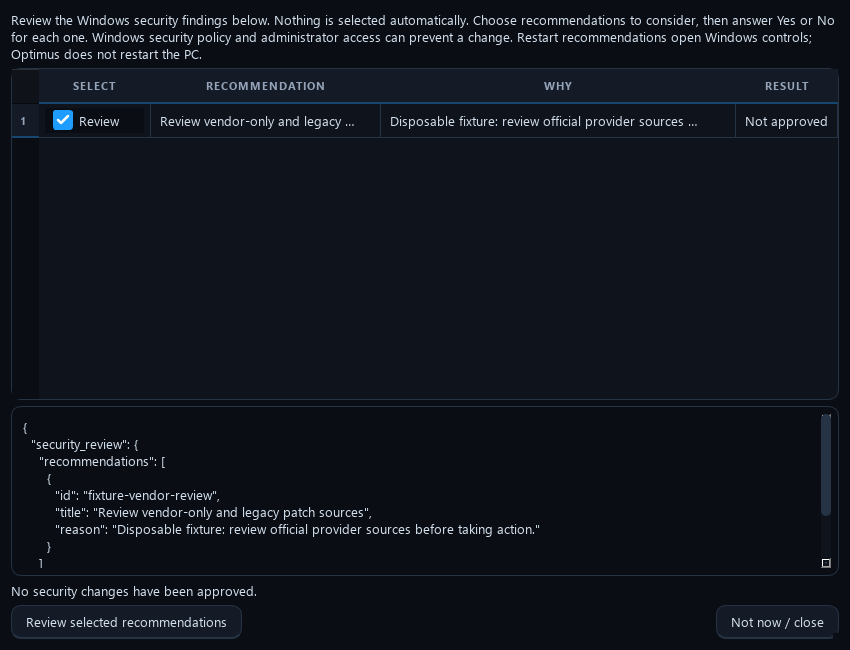

# App policies and worker controls

Optimus 0.11.1 adds persistent exact-app rules and controls for individual worker items. These features use the saved maintenance scope; no application rule is enabled by default.

## App choices

In initial setup or Settings → Updates, add an exact package identity and its supported source. Each row has two choices:

| Choice | Behavior during saved maintenance |
| --- | --- |
| Follow global update settings | Uses the selected-app/all-supported/review policy already configured. |
| Always update | Includes this exact installed app when a fresh supported catalog scan offers a genuinely newer eligible version. |
| Always ignore updates | Excludes this exact app from automatic updates. Existing exclusions still take precedence. |
| Keep current state | Makes no automatic install/uninstall presence change. |
| Keep installed | Reinstalls this exact app if a fresh supported installed-state query proves it absent. |
| Keep uninstalled | Removes this exact app if it reappears; also ignores its updates. |

The **Software Updater** master switch controls all of these rules. Save choices and the required agreement approval before automatic changes. Rules and their exact install/removal scope appear in launch review. Changing a rule invalidates the old unattended scope approval. Removing an app can remove its data; changing its policy back does not restore that data. Existing pins, version holds, system/security/app protections, restart/space/permission checks and unknown-installer barriers remain enforced.

Update rules work with the platform's supported updater. Automatic presence changes currently require Windows and the verified built-in WinGet source. Recognized quiet installer handlers are MSI, WiX, MSIX/AppX, Burn and Inno. Generic EXE, Nullsoft, portable/archive or ambiguous/localized metadata is left for review. Sources, exact release metadata and installed state are checked before action, and a fresh installed-state query verifies the result. WinGet retains its own installer hash/signature checks. Optimus records known failures, partial results and unknown outcomes; returning from a launcher alone does not establish success. macOS/Linux retain native update rules but report automatic presence changes as unavailable.

Windows calls use the documented [WinGet install](https://learn.microsoft.com/en-us/windows/package-manager/winget/install), [uninstall](https://learn.microsoft.com/en-us/windows/package-manager/winget/uninstall) and [source](https://learn.microsoft.com/en-us/windows/package-manager/winget/source) mechanisms. No security-check bypass, automatic reboot, arbitrary download execution or raw program-folder deletion is used.

## Worker arrows

Each primary worker card has Back (←), Next (→) and Cancel item (×). Commands are bound to the current workflow session, worker and item revision. A stale click is rejected so it cannot silently affect the next package.

- **Back:** reviews earlier recorded results. Completed changes are not replayed or undone; retry earlier work through a fresh reviewed run.
- **Next while viewing history:** moves forward through recorded details and returns to the live item.
- **Next at the live item:** requests a skip of that item, then continues after the current native operation returns safely.
- **Cancel item:** requests cancellation of the live item only. The separate bottom Cancel button still stops the entire run at a safe boundary.

A live installer keeps its worker, installer slot and maintenance lease until its actual outcome is recorded. An API that combines download and installation may not allow an immediate download abort; the card explains the wait. Pending commands are disabled until consumed. Unknown outcomes retain the existing review barrier. Use the red Revert control for the specific completed changes that support undo.

Known terminal failures and unsupported individual items keep their saved results and advance to the next eligible item. Shared conditions such as an untrusted source, insufficient space, missing administrator access or a required restart pause affected installations. If an installer might still be running or its result cannot be verified or saved, further conflicting changes wait for review while independent checks and final verification continue. Fail-forward does not turn a failed item into a successful result.

An exact-version hold skips that app release and retains its reason while other eligible apps continue. **Finished with skips** describes the recognized queue's terminal state. **Scan incomplete** remains visible when some source offers could not be verified; it does not mean every installed app is current. The maintenance card names the active app or driver worker it is waiting for. A finished app with skipped offers does not own the driver installer's wait.

This disposable fixture shows one held app and two unverified source offers. The driver is the active worker; the overall workflow is still at 44%.

## Safe continuation in one run

While app and driver catalogs are searching, maintenance can perform already-approved independent inventory, resource and privacy checks. Shared temporary-file cleanup waits until discovery releases its staging files; installers still wait until that cleanup finishes. Cancellation keeps the worker and maintenance lease until its active operation returns.

Known package-specific failures keep their reason and advance to the next eligible app or driver. Driver offers that disappear, change identity or cannot support unattended interaction are skipped before installation. A failed driver download permits continuation only with complete, terminal native result codes; unknown or shared errors keep their barrier. No blind retry, unsupported driver forcing or automatic restart is added.

A prior unresolved installer blocks conflicting cleanup and installations while independent checks continue. Follow-up previews show those channels as manual review, with the actual reason, rather than advertising an automatic attempt that must defer. A later barrier records that this follow-up did not start an installer or perform a fresh update search. No extra app launch is needed to advance past a known package-local refusal.

## Security recommendation selection

This disposable fixture shows the **Review** checkbox selected. Each row has one labeled control; selecting it only enables **Review selected recommendations**. A separate **Yes — apply / No — skip** question determines whether each recommendation runs. Nothing is selected or approved by default.

## Driver installation

Automatic backup targets only the installed packages matched to approved offers. OEM packages use PnPUtil export. Signed Microsoft inbox packages can use a complete private DriverStore and signed-catalog snapshot, with native forward/reverse INF binding, source/destination hashes and a final device-identity recheck. Protected Windows files and permissions are never modified by backup. An inbox snapshot is recovery evidence: Windows Device Manager may offer rollback, but automatic reinstall or successful rollback is not guaranteed. It is kept separate from the OEM restore catalog.

Only an exact offer with verified backup evidence can reach Windows Update installation. Unsupported identities, trust or copy failures remain per-offer skips; other eligible offers continue. A backup prerequisite is reported separately from failed driver installations. Quiet-install, hardware/provider/date, agreements, permissions, space and restart checks still apply.

## Current-item progress and system status

This interface example uses disposable fixture values; it is not a benchmark or a reading from your computer.

The **Current item** ring shows the reported percentage for the named operation and phase. It resets when a different package or phase starts: download 25% is not install 25%, and finishing one package does not carry 100% into the next. The ring stays indeterminate when the native operation does not expose reliable progress. Reduced motion can stop its animation while the percentage remains unavailable. CPU use, elapsed time and package counts never fill in a missing percentage.

Cleanup uses the number of preview-approved file decisions completed; preserved/locked files remain explicit and are not counted as deleted. Privacy controls show the number of durably checked selected settings; a completed check can be unsupported or refused. Driver offer/device record processing uses the returned collection size. Native Windows Update catalog searching exposes no intermediate percentage, so that phase remains a labeled scanning indicator rather than a time-based estimate.

An approximate download value, such as **~62%**, comes from the updater's own downloaded/total counters in the same unit. Those displayed counters can be rounded, so the estimate is labelled explicitly. It is not a time estimate or a measurement of installation progress. An opaque installer still shows an indeterminate ring until it reports usable progress or returns its actual outcome.

The separate bars show completed workflow stages or processed queue entries. Three of four packages processed does not establish 75% completion of the current installer. A phase reaching 100% also does not prove that installation succeeded; the recorded native outcome and verification determine the result. Reviewing an earlier item with Back does not replay its operation.

The live status area reports computer CPU use, available clock information, RAM use and passive network receive/transmit rates. Wi-Fi identification and link rates depend on available native interface information. A zero receive rate can mean no download is occurring. These counters do not run an internet speed test or establish that every remote update server is reachable. Status colors explain observed work, waiting, resource pressure and errors; they are not a universal performance score.

The app above is a disposable review fixture. Real rules take effect only after Save and the required scope/agreements are approved.

## Automatic update recovery

Stable Unity editor releases use the documented final-release `f` version order only within the exact `Unity.Unity.<major>` package track. A numeric installed-version upper bound such as `< 3.21.0.65535` is accepted only when an exact numeric offer is strictly greater than that bound. Unknown, prerelease, mixed-track and ambiguous versions stay excluded. Fresh exact-pair validation, exclusions, pins and saved scope still apply.

Selected held offers receive at most one bounded metadata pass per approved run, with a six-hour cooldown and five-offer limit. Optimus verifies and refreshes only the existing official WinGet source, then checks exact offer metadata. It does not reset/add sources, clear holds, accept new licences or run an installer based on metadata alone. A publisher correction is awaited automatically on later approved runs; this is not a separate background timer. A failed or uncertain source check is recorded durably and prevents affected app installs until trust and a fresh approved-pair scan succeed. Independent maintenance and driver work continue.

## Fresh startup and previous failures

Every new application session starts with fresh progress and worker state. Each approved maintenance run performs fresh update discovery; a known completed package failure does not permanently disable later eligible attempts. The prior result remains in history and the current run still validates saved scope, current offers and readiness.

Startup does not delete installer journals, exact bad-artifact holds or recovery records. A still-running or unresolved installer, pending restart, untrusted source or mismatched artifact needs its own verified resolution. Forgetting that evidence could launch duplicate installers or repeat the same bad package. Held offers keep their bounded automatic metadata rechecks while unrelated eligible work continues.
