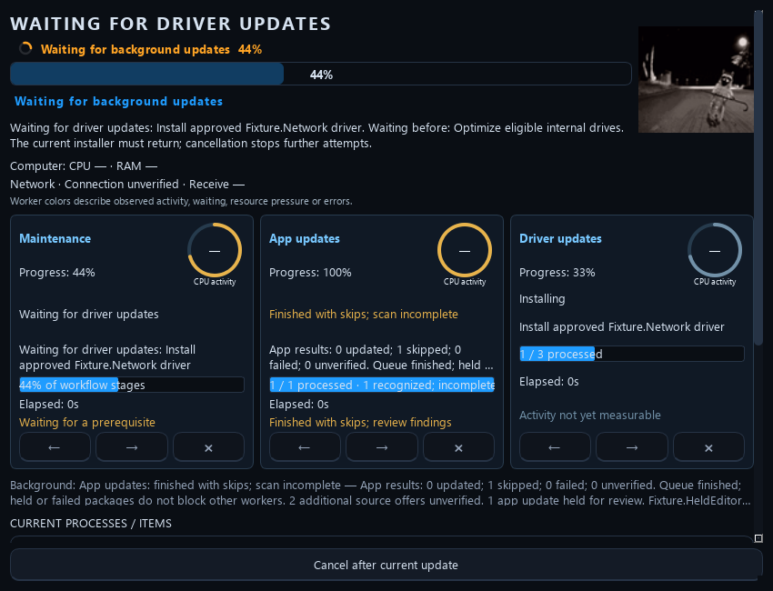
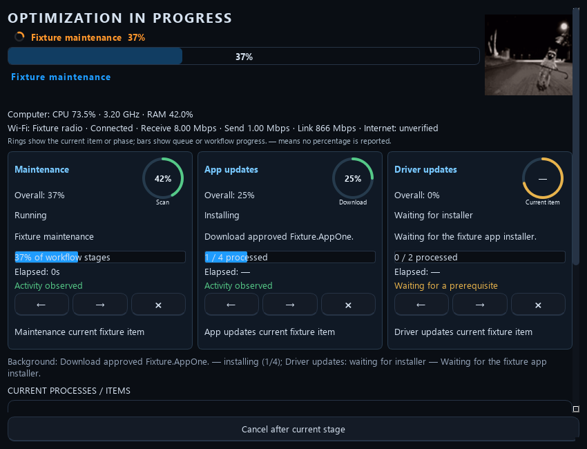
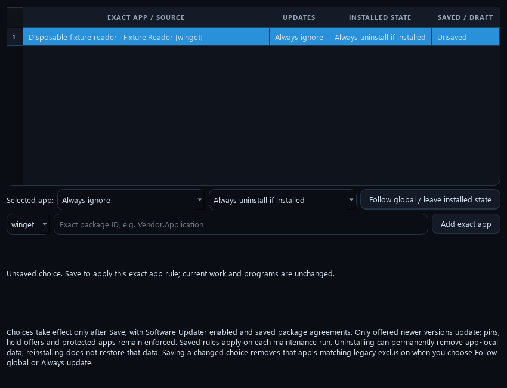

# App policies and worker controls

Optimus 0.11.1 adds persistent exact-app rules and controls for individual worker items. These features use the saved maintenance scope; no application rule is enabled by default.

## App choices

In initial setup or Settings → Updates, add an exact package identity and its supported source. Each row has two choices:

| Choice | Behavior during saved maintenance |
| --- | --- |
| Follow global update settings | Uses the selected-app/all-supported/review policy already configured. |
| Always update | Includes this exact installed app when a fresh supported catalog scan offers a genuinely newer eligible version. |
| Always ignore updates | Excludes this exact app from automatic updates. Existing exclusions still take precedence. |
| Keep current state | Makes no automatic install/uninstall presence change. |
| Keep installed | Reinstalls this exact app if a fresh supported installed-state query proves it absent. |
| Keep uninstalled | Removes this exact app if it reappears; also ignores its updates. |

The **Software Updater** master switch controls all of these rules. Save choices and the required agreement approval before automatic changes. Rules and their exact install/removal scope appear in launch review. Changing a rule invalidates the old unattended scope approval. Removing an app can remove its data; changing its policy back does not restore that data. Existing pins, version holds, system/security/app protections, restart/space/permission checks and unknown-installer barriers remain enforced.

Update rules work with the platform's supported updater. Automatic presence changes currently require Windows and the verified built-in WinGet source. Recognized quiet installer handlers are MSI, WiX, MSIX/AppX, Burn and Inno. Generic EXE, Nullsoft, portable/archive or ambiguous/localized metadata is left for review. Sources, exact release metadata and installed state are checked before action, and a fresh installed-state query verifies the result. WinGet retains its own installer hash/signature checks. Optimus records known failures, partial results and unknown outcomes; returning from a launcher alone does not establish success. macOS/Linux retain native update rules but report automatic presence changes as unavailable.

Windows calls use the documented [WinGet install](https://learn.microsoft.com/en-us/windows/package-manager/winget/install), [uninstall](https://learn.microsoft.com/en-us/windows/package-manager/winget/uninstall) and [source](https://learn.microsoft.com/en-us/windows/package-manager/winget/source) mechanisms. No security-check bypass, automatic reboot, arbitrary download execution or raw program-folder deletion is used.

## Worker arrows

Each primary worker card has Back (←), Next (→) and Cancel item (×). Commands are bound to the current workflow session, worker and item revision. A stale click is rejected so it cannot silently affect the next package.

- **Back:** reviews earlier recorded results. Completed changes are not replayed or undone; retry earlier work through a fresh reviewed run.
- **Next while viewing history:** moves forward through recorded details and returns to the live item.
- **Next at the live item:** requests a skip of that item, then continues after the current native operation returns safely.
- **Cancel item:** requests cancellation of the live item only. The separate bottom Cancel button still stops the entire run at a safe boundary.

A live installer keeps its worker, installer slot and maintenance lease until its actual outcome is recorded. An API that combines download and installation may not allow an immediate download abort; the card explains the wait. Pending commands are disabled until consumed. Unknown outcomes retain the existing review barrier. Use the red Revert control for the specific completed changes that support undo.

Known terminal failures and unsupported individual items keep their saved results and advance to the next eligible item. Shared conditions such as an untrusted source, insufficient space, missing administrator access or a required restart pause affected installations. If an installer might still be running or its result cannot be verified or saved, further conflicting changes wait for review while independent checks and final verification continue. Fail-forward does not turn a failed item into a successful result.

An exact-version hold skips that app release and retains its reason while other eligible apps continue. **Finished with skips** describes the recognized queue's terminal state. **Scan incomplete** remains visible when some source offers could not be verified; it does not mean every installed app is current. The maintenance card names the active app or driver worker it is waiting for. A finished app with skipped offers does not own the driver installer's wait.

This disposable fixture shows one held app and two unverified source offers. The driver is the active worker; the overall workflow is still at 44%.

## Driver installation

Automatic driver backup targets the installed OEM driver packages matched to the actual approved offers. It avoids exporting unrelated packages from the entire driver store before every batch. Each selected package must have verified backup files before its update is eligible to install. Unsupported mappings, inbox packages without an exportable backup, export failures and changes in identity are reported per offer. Other backed-up eligible offers can continue. Windows Update quiet-install, hardware/provider/date, agreement, permission and restart checks still apply.

## Activity indicators

This interface example uses disposable fixture values; it is not a benchmark or a reading from your computer.

Worker completion percentages and measured worker CPU activity have separate labels. Worker CPU covers attributable Optimus runner threads; Windows Update services and vendor installers can do work outside those threads. Missing or ambiguous attribution stays unavailable.

The live status area reports computer CPU use, available clock information, RAM use and passive network receive/transmit rates. Wi-Fi identification and link rates depend on available native interface information. A zero receive rate can mean no download is occurring. These counters do not run an internet speed test or establish that every remote update server is reachable. Status colors explain observed work, waiting, resource pressure and errors; they are not a universal performance score.

The app above is a disposable review fixture. Real rules take effect only after Save and the required scope/agreements are approved.
