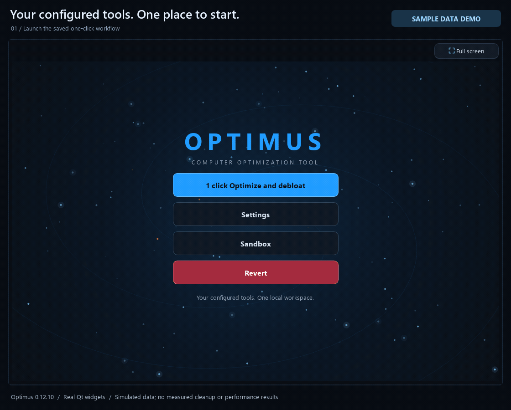
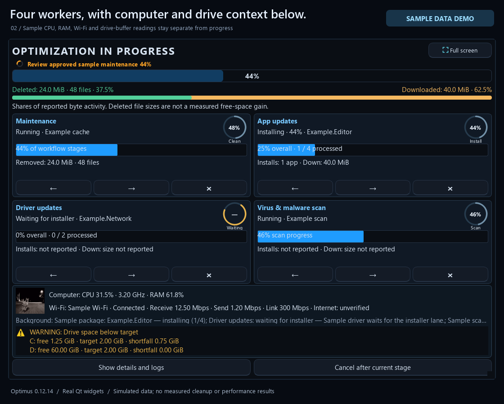
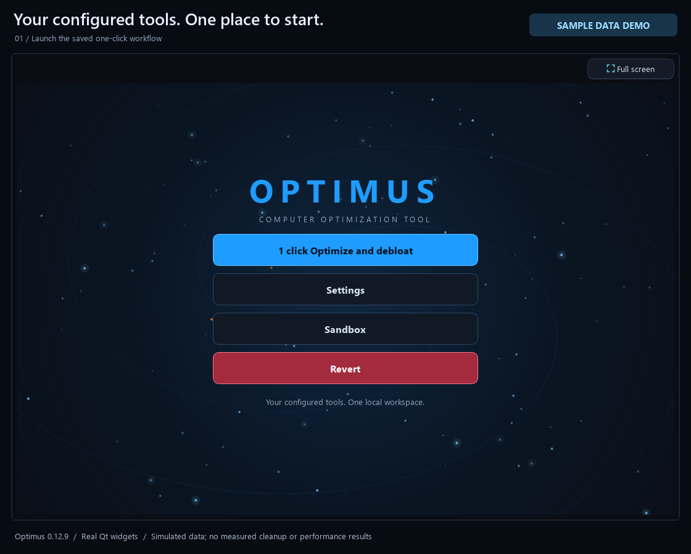
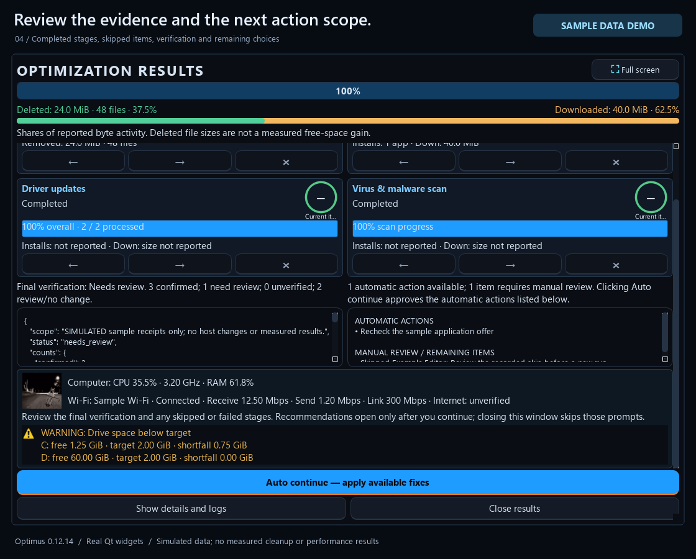
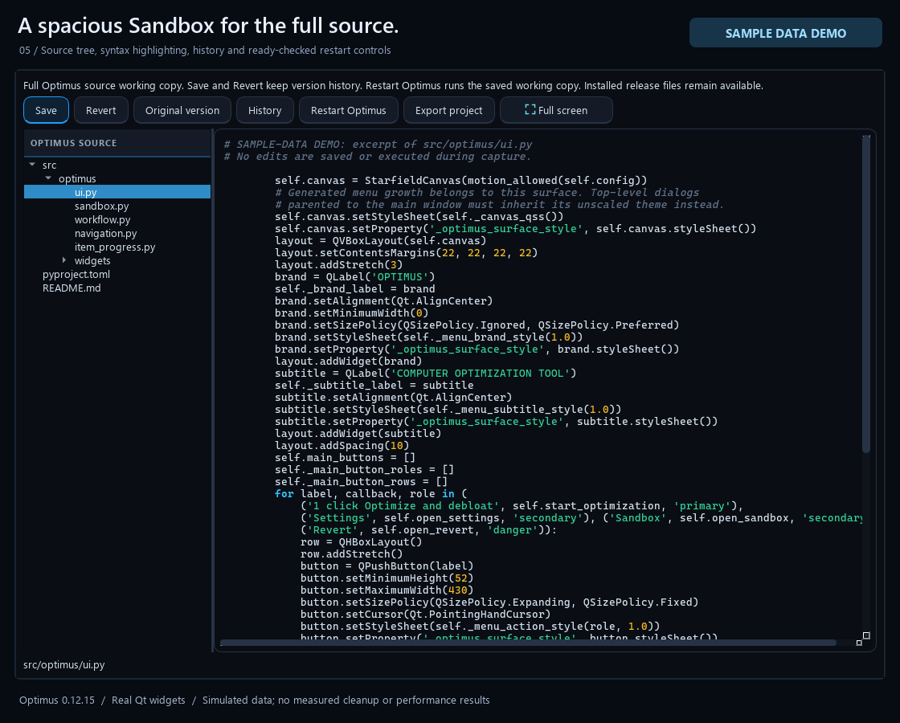

# Optimus demo gallery

See the main controls, live worker layout, bottom resource/disk panel, full-screen controls, completion review and editable Sandbox in Optimus 0.12.10.

**These are sample-data previews.** They render the real Qt interface against an inert fixture backend. Every frame is labelled **SAMPLE DATA DEMO**. Progress, file counts, download sizes, update offers and outcomes are simulated; they do not describe the capture computer or establish a performance gain, successful live update, driver installation or recovery.

The capture does not run cleanup, launch installers, scan with Defender, connect a cloud account or change startup, services, drivers, registry, browser records or system settings. It uses disposable local demo state. Windows-specific features shown here retain the limits in the [platform matrix](PLATFORMS.md); the screenshots do not demonstrate identical capabilities on every platform.

## Animated overview

The GIF gives a quick overview. For the video walkthrough, open the linked poster below; GitHub README pages do not need an embedded HTML video player.

[Watch/download the MP4 walkthrough](media/optimus-walkthrough.mp4)

## Main controls

Optimize runs saved modules. Settings holds the individual scopes, optional toolkit and recovery tools. Sandbox edits the bundled source; Revert reviews supported recorded undo. Normal maintenance requires launch review unless the exact unattended scope was explicitly approved. [Setup and one-click behavior](ONE_CLICK_COVERAGE.md)

## Four worker cards

Maintenance, App updates, Driver updates and Virus scan have their own state and navigation. Overall queue progress is separate from the current item. Supported providers supply progress; opaque operations remain indeterminate. Next/Cancel requests use the operation's supported boundary, and an active installer keeps its actual outcome. [Worker layout and skip behavior](worker-layout-and-skip.md)

The bottom panel keeps the gag animation, CPU/RAM/network observations and drive free-space targets visible outside the Details toggle. Details reveals Current processes and Stage log. Smaller windows scroll vertically; primary actions stay accessible. The Full screen button or F11 expands the main, progress or Sandbox window, and Esc returns to its previous size.

## Completion and verification

Results retain verification evidence, exclusions, failures and unknown outcomes. Available fixes stay scoped to what can run under the current approvals. A finished worker does not prove every requested effect succeeded, and a before/after observation does not prove a cleanup-caused speed gain. [Feature/result limits](FEATURES.md#how-to-assess-a-result)

## Editable Sandbox

Inspect and edit the bundled public source, save validated Python, review history, revert, export and explicitly restart the edited version. The file tree and editor expand into the available space. Sandbox is a source workspace; edited code executes with the current account's permissions and is not OS process isolation. [Source and platform notes](PLATFORMS.md)

## Capture details

The reproducible generator is [tools/capture_demo.py](../tools/capture_demo.py). It uses the checked-out UI code and a fixture backend rather than a live maintenance backend. Its docstring provides the capture command. The [media manifest](media/manifest.json) records source/version, fixture scope, dimensions, encoding, durations and file sizes.

These images show interface behavior using sample data. They are not release-build verification, live-account coverage, a driver compatibility claim or a benchmark. See the [full feature matrix](FEATURES.md), [removal/privacy options](REMOVAL_OPTIONS.md) and [native platform capabilities](PLATFORMS.md) before choosing a maintenance scope.

[Back to the README](../README.md)
