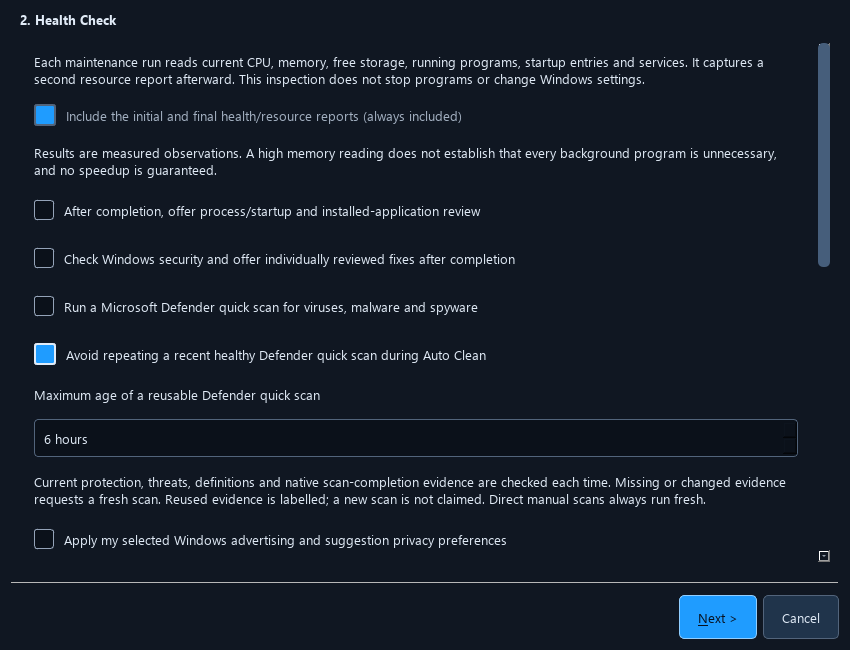

# Automatic efficiency

Optimus 0.12.28 reduces the work its own maintenance and monitoring need to do.
These defaults add no cleanup folder, uninstall target or update approval.
Existing saved choices, exclusions and browser scopes remain in effect.

This screenshot uses fixture settings. It does not show a scan or changes made
to a user's computer.

## Avoid duplicate inventory queries

On Windows, **Reuse complete application/startup review metadata briefly within
this run** starts enabled. The first complete maintenance audit can supply
independent copies to subsequent application, startup and background-program
reviews for up to 30 seconds. Incomplete, oversized or expired inventories fall
back to a fresh read. The cache is held only in memory for that run.

Changes to installed applications, startup registrations and related controls
discard the review cache. Acquiring an app or driver installer slot discards it
before installation; it cannot be repopulated by the final audit. Uninstall and
startup action validation still use fresh inventories. Process identities,
security state, driver offers, package versions and approval decisions are never
taken from this cache. The run report records the number of inventories reused.

## Avoid redundant Defender scans

On Windows, **Avoid repeating a recent healthy Defender quick scan during Auto
Clean** starts enabled with a six-hour window. Setup and Settings offer a toggle
and a 1–24 hour limit. It applies only to the automatic workflow; directly
requesting a manual scan always requests a new scan.

Reuse requires freshly read protection, threats, signature and native scan-event
evidence. A timestamp by itself is insufficient. Changed definitions, active
threats, incomplete or contradictory evidence, an overdue scan or an active scan
prevent reuse. Optimus then follows its existing fresh-scan path, including
normal Windows permissions and provider checks.

Retained detection history remains available for review. An old, inactive
Defender `ABANDONED` record does not by itself force repeated scans when its
native initial/change timestamps and successful action metadata all predate the
independently verified recent scan. Missing dates, newer or unresolved records
and unknown statuses still prevent reuse. This does not clear detection history
or approve any threat removal. Microsoft's
[native threat-status definitions](https://learn.microsoft.com/en-us/windows/win32/lwef/mpthreat-status)
define these states.

Results explicitly say when a recent scan was reused. They do not claim that a
new scan completed, display an invented scan percentage or guarantee that the
computer is free of malware. Defender's protection, scheduled scans, quarantine
and remediation policies remain under Windows control.

## Lighter live monitoring

The Windows dashboard queries at most 12 identified Optimus worker threads
instead of enumerating all of its process threads every sample. Read-only thread
handles are checked for process ownership, lifetime and counter continuity, then
closed. An unavailable or replaced thread produces an unknown reading rather
than an artificial zero. Idle dashboards with no worker thread IDs perform no
thread census. macOS and Linux keep their native monitoring path and omit the
thread census when no workflow worker needs attribution.

This changes monitoring cost, not the CPU priority of another application. It
does not suspend processes, purge useful RAM or modify Windows security.

A Windows comparison with four waiting Optimus-owned workers and 30 alternating
samples measured median full-sample time of 131.64 ms before and 39.01 ms after
this change, about 70% lower sampling cost. This is one machine under concurrent
development load, not an overall PC or installer speedup. See the
[aggregate measurements](telemetry-benchmark-028.json). From a source checkout,
run `python tools/benchmark_live_metrics.py --samples 30 --workers 4` to repeat
the read-only comparison; no host settings are changed.

## Related existing automation

Optimus already offers opt-in workload/idle/AC/metered-network start conditions,
low-space cleanup within selected categories, Smart Cleaning cooldowns, tracked
installer-download removal after verified updates and per-volume drive
optimization cadence. Those saved settings are preserved. See the
[maintenance toolkit](maintenance-toolkit.md) and
[performance diagnostics](performance-diagnostics.md).

Microsoft's [Windows performance guidance](https://support.microsoft.com/en-gb/windows/experience/performance-optimization/tips-to-improve-pc-performance-in-windows)
describes storage, startup and background activity as areas to examine. The
monitor uses documented read-only Windows APIs:
[OpenThread](https://learn.microsoft.com/windows/win32/api/processthreadsapi/nf-processthreadsapi-openthread),
[GetThreadTimes](https://learn.microsoft.com/windows/win32/api/processthreadsapi/nf-processthreadsapi-getthreadtimes)
and [GetProcessIdOfThread](https://learn.microsoft.com/windows/win32/api/processthreadsapi/nf-processthreadsapi-getprocessidofthread).
