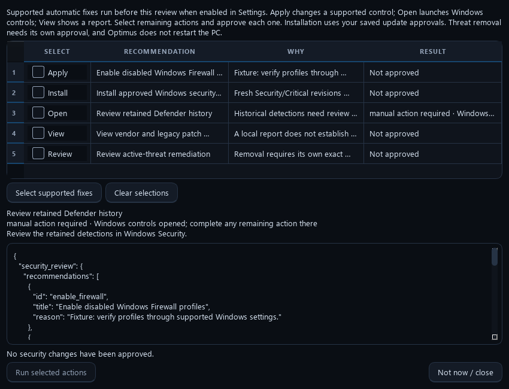

# Automatic fixes and installation

Optimus runs the maintenance and update choices you saved. With **Automatically continue with supported post-scan fixes** enabled, a completed scan also starts one follow-up batch without another click. A failed or held package does not justify retrying that same installer or discarding its recorded outcome.

## What happens automatically

- Supported Defender/firewall corrections are attempted and checked again. A known, finished failure of one control leaves unrelated fixes eligible. A running or uncertain operation remains a stop boundary.
- App and driver workers search fresh offers and install eligible updates within saved scopes and agreements. Missing apps are installed only through an explicit **Keep installed** app rule.
- After a successful, finished app installer, an unchanged healthy version readback gets up to two additional read-only queries within a four-second retry window. An update whose version appears late can then be verified without reinstalling it. Running installers, restart requirements, invalid inventory and cancellation do not enter this retry path.
- An approved Windows Security/Critical update recommendation uses the native installer and verifies exact revisions against local installation history. It opens Windows Update instead when automatic installation is not approved.
- Driver offers with no exact present-device match retain saved approval and are checked on later approved maintenance runs. Optimus does not install a driver for a disconnected or unmatched device.

## Reading the remaining recommendations

The review labels state the action: **Apply** changes a supported security control, **Install** uses saved update approval, **Open** launches Windows controls, and **View** displays a coverage report. Selecting supported fixes excludes report links, restart controls and threat-removal decisions. Results show the reason, installation evidence and any remaining manual step.

Fixture demonstration at 850 × 650. No host changes or installations were performed for this image.

An exception in automatic follow-up leaves the original recommendations available for review. It does not start the batch again. Action services still check current state before changing anything.

Historical Defender detections and vendor/legacy coverage are reports, not proof that something needs installing or deleting. Current threat removal requires its own exact-scope approval. Known failed publisher offers, unresolved installers, Windows policy, disconnected hardware and restart requirements can still prevent installation; each remains visible in the saved results.

## Saved choices

Existing opt-outs, app exclusions, device approvals, accepted agreements and unattended settings are preserved. To install Windows security patches automatically, enable their installation approval and accept their agreements in setup or Settings. To remove launch questions, explicitly save **Auto clean with these settings** for the intended scope. Neither choice approves automatic PC restarts or forced application closure.
