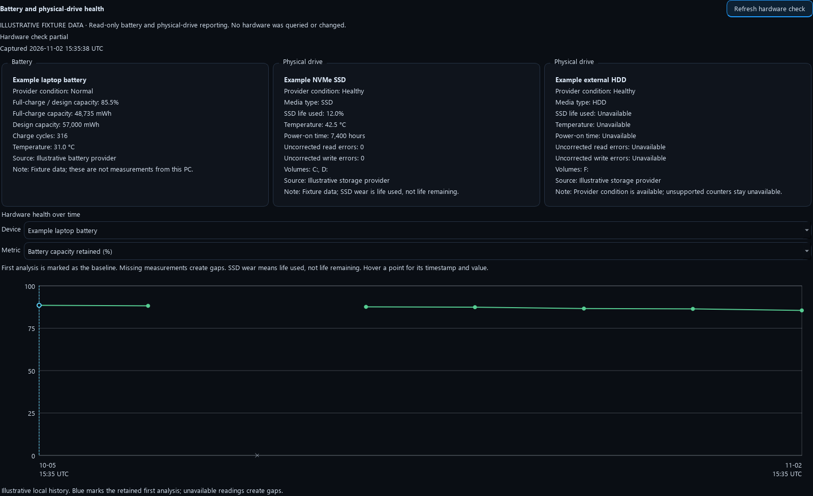
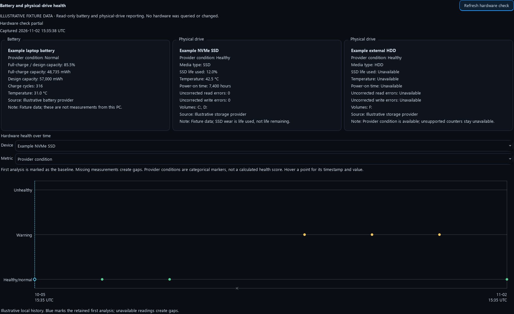

# Battery and physical-drive health

Optimus checks battery and physical-drive health once during each normal maintenance run by default. The Maintenance worker shows separate battery and drive summaries. **Health** opens the captured snapshot and local trend graphs while other work continues. **Settings → Dashboard → Battery / drive health & history** also offers an explicit fresh scan. The automatic check can be turned off in setup or Settings.

These are provider observations, not a surface scan, repair or prediction of remaining service life. They do not run SMART self-tests, change power settings, install software, repair disks or replace firmware. A slow, missing or denied provider returns unavailable data and maintenance continues.

*Illustrative fixture data. These example readings are not measurements from a user's computer.*

## Battery readings

- Full-charge capacity compared with design capacity, where both are exposed in the same units. This is capacity retained, **not current charge**.
- A native maximum-capacity percentage on supported macOS batteries, without invented absolute capacities.
- Available cycles, temperature and reported condition.

Zero/invalid design or full-charge capacities do not produce a zero-health reading. Values slightly above 100% can reflect the provider's estimate and are shown as reported. Unsupported counters remain unavailable.

## Drive readings

Each physical drive has its own entry. Available fields include provider/SMART condition, temperature, estimated endurance used, power-on hours and historical uncorrected errors. Partitions and drive letters are associated only through verified native identity mapping. A volume's free space is not its physical health.

**SSD life used** is separate from health: 100% used means the reported endurance estimate has reached its design limit. Optimus does not invert it into a universal “health remaining” score. Healthy/normal, warning and unhealthy conditions use a categorical history graph, never a made-up percentage.

USB bridges, RAID controllers, virtual disks and vendor drivers can hide measurements. Unsupported SMART or missing counters are not a clean bill of health. macOS and Linux use supported native data; Linux can use a suitable, already-installed trusted SMART tool without downloading anything or waking a standby drive for a scan.

## Baseline and subsequent scans

Every completed observation is saved locally under the Optimus data folder in `hardware-health/history.json`. The first observation remains the baseline. Later scans retain their real timestamps and per-device readings. Missing measurements create gaps, and the graph shows the available fields for each selected device.

Only an opaque hash of a reliable hardware identity allows connected trend lines. Replacing a device starts a separate baseline. Unidentified devices show isolated observations; names, slots and drive letters cannot prove hardware continuity. Raw serial numbers and hardware identifiers are not exported.

Graphs show up to 500 points per metric, retaining the baseline and recent scans and visibly breaking any omitted interval. The original observations remain in local history. Recording is bounded to 20,000 scans, 256 historical device identities and 32 MiB. Reaching a limit stops new history recording with a visible status; it never deletes the baseline or older scans. No new persistent monitoring service is installed.

*Illustrative condition history. Hover a point for its scan time and reported value; conditions are categories rather than percentages.*

Provider references: [Microsoft storage reliability counters](https://learn.microsoft.com/en-us/windows-hardware/drivers/storage/msft-storagereliabilitycounter), [Windows battery information](https://learn.microsoft.com/en-us/windows/win32/power/battery-information-str), [Linux power-supply ABI](https://www.kernel.org/doc/Documentation/ABI/testing/sysfs-class-power), [Apple battery health](https://support.apple.com/en-us/102589).
