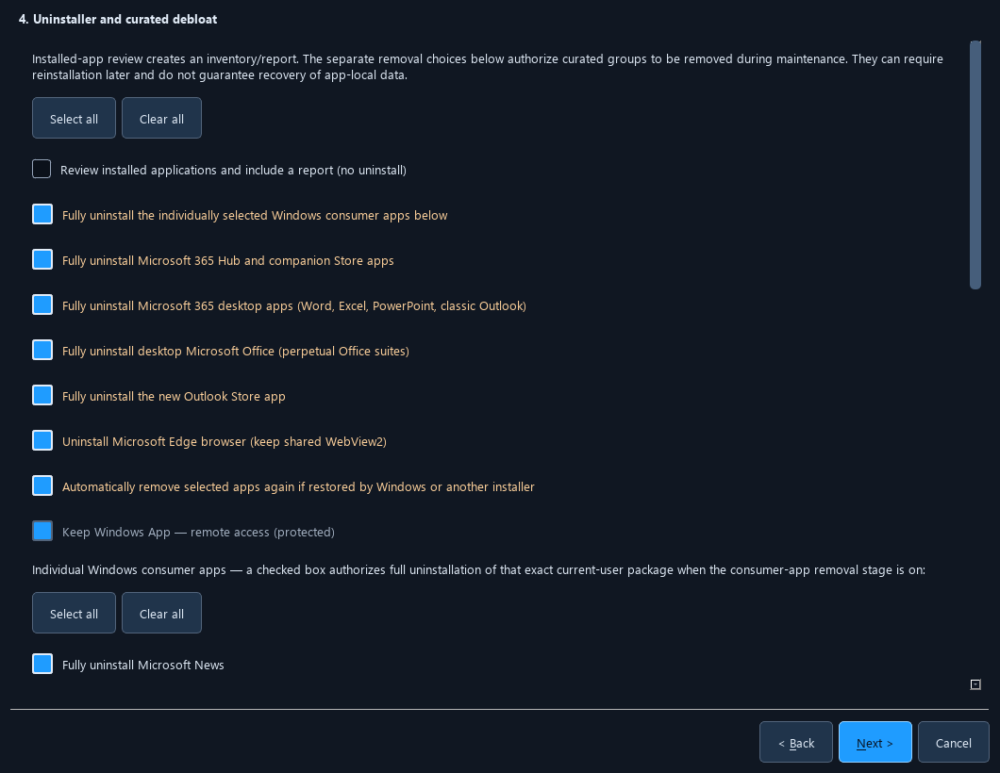

# Office, Edge and Windows privacy choices

Optimus separates desktop suites from their Store shortcuts and companion apps. Each removal has its own switch in **Settings → One-click workflow** and the initial setup questions. New Windows installations select these removal groups and reappearance checks by default. Review the choices before saving: normal launches still show **Auto Clean / Adjust settings**, and unattended cleanup requires its separate approval. Existing saved On/Off choices are retained.

This image uses disposable setup preferences; it does not show a user's installed-app inventory.

## What each switch removes

| Setting | Scope and effect |
| --- | --- |
| **Fully uninstall the individually selected Windows consumer apps** | Uninstalls only the checked exact packages. Individual choices cover News, Weather, Tips, Solitaire, 3D Viewer, Print 3D, Mixed Reality Portal, People, Maps, Feedback Hub, Cortana, Skype, Dev Home, PC Manager, Family, Clipchamp, personal/new Teams, Copilot, and the Office Store packages below. Clear an individual checkbox to keep that package. |
| **Fully uninstall Microsoft 365 Hub and companion Store apps** | Removes the Microsoft 365 Hub and supported companion packages. This switch alone does **not** uninstall desktop Word, Excel, PowerPoint or classic Outlook. |
| **Fully uninstall Microsoft 365 desktop apps** | Runs the registered Microsoft uninstaller for eligible Microsoft 365 subscription suites. This removes the suite's applications, including classic Outlook when included in that suite. |
| **Fully uninstall desktop Microsoft Office** | Runs the registered Microsoft uninstaller for eligible perpetual Office suites, separately from Microsoft 365 subscription products. |
| **Fully uninstall the new Outlook Store app** | Removes the separate new Outlook package; classic Outlook follows its desktop suite's switch. |
| **Uninstall Microsoft Edge browser (keep shared WebView2)** | Attempts native removal of the exact Edge browser installation. It preserves shared WebView2, EdgeCore, updater components and browser profiles. |
| **Automatically remove selected apps again if restored** | Registers a separate background task to remove returning selected apps, even while the GUI is closed. See the schedule and limitations below. Turning this off revokes reappearance enforcement; selected removals can still run during normal maintenance. |

**OneNote (Store app)**, **Microsoft Office Actions Server** and **Microsoft Office Push Notification Utility** have separate checkboxes in the consumer list. Store OneNote removal can delete app-local data or offline notebook caches; sync or export anything needed first. Personal document folders are not deletion targets. Desktop OneNote may instead be part of its installed Office suite.

Desktop suite removal validates the exact product registration, installed product identity, Microsoft signature and native uninstall arguments before starting. Optimus does not force-close an open Office document. An unsupported registration or open Office program is reported for review while independent eligible work can continue. Suite removal can leave files shared with another installed Office product or language. Reinstall the original product from its Microsoft account or organization to use it again; an uninstall has no automatic undo. Microsoft's [Office uninstall guidance](https://learn.microsoft.com/en-us/troubleshoot/microsoft-365/admin/miscellaneous/get-help-office-uninstall) and [product-specific deployment removal options](https://learn.microsoft.com/en-us/microsoft-365-apps/deploy/office-deployment-tool-configuration-options#remove-element) describe the distinction between a selected product and removing all Office products.

## Windows App stays installed

**Keep Windows App — remote access (protected)** is always checked and cannot be cleared. Its exact package family is `MicrosoftCorporationII.Windows365_8wekyb3d8bbwe`. Consumer-app Select all, Office removal and returning-app checks cannot select it for removal. Older saved selections that included its package name are filtered out without resetting unrelated choices.

Frameworks and shared Windows runtimes are also preserved. WebView2 has a [separate runtime distribution and update lifecycle](https://learn.microsoft.com/en-us/microsoft-edge/webview2/concepts/distribution); browser removal does not authorize deleting that runtime. Bing Wallpaper stays protected. **Settings → Protected apps** lets you keep additional supported apps from curated debloat and per-app removal.

## Edge removal and reappearance checks

Edge removal tries a source-checked exact WinGet uninstall, a matching signed Microsoft setup command when eligible, and exact removable Edge Store registrations. A successful installer exit alone is insufficient: Optimus checks whether the browser executable remains. If Windows refuses removal or requires a restart before absence can be established, the result stays visible as a finding. There is no promise to delete the entire `Microsoft` folder, shared EdgeCore or WebView2.

On devices where the documented policy applies, Optimus can additionally set the Edge Stable installation policy while keeping its previous value for recovery. Microsoft limits [Edge Update installation policy](https://learn.microsoft.com/en-us/deployedge/microsoft-edge-update-policies#install) to Active Directory domain-joined Windows devices. A standalone Home/Core computer cannot rely on that policy to prohibit a Windows feature upgrade or a manually run installer from restoring Edge. Optimus reports this limitation instead of treating an unsupported registry write as protection. Enterprise-only [policy-based inbox app removal](https://learn.microsoft.com/en-us/windows/configuration/policy-based-inbox-app-removal/policy-based-inbox-app-removal) is likewise not a Home/Core feature.

After you save the current approved scope, selected removals run during maintenance. The separate reappearance guard also checks at user sign-in, every 15 minutes and after a successful Windows Update event, even when the GUI is closed. It is independent of **Launch at sign-in**, which controls the main Optimus window. Simply opening an idle GUI does not start an uninstall. These are removal checks after reappearance, not a universal block on installing applications. The guard uses only the saved selected packages, suite groups and exclusions. Changing the reviewed removal/privacy preferences requires saving approval for the new scope. Existing explicit keep/off choices survive Optimus updates. Privacy controls apply during Auto Clean; this background task does not reapply registry privacy settings, which persist where Windows supports them.

The administrator-protected Task Scheduler action embeds fixed native code and the exact approved scope captured by **Save choices** or **Save one-click configuration**. It does not run an elevated script from a user-writable folder or follow a user-writable startup manifest to select an executable. At runtime, the current saved preferences must still approve that captured scope; they cannot supply replacement code or expand its authority. Re-save the reviewed settings after an Optimus update to refresh the guard's captured native implementation. Saving unrelated startup, app rules or toolkit preferences does not grant a new removal approval.

Saving this checked background-removal option enables its future checks even if **Run selected maintenance now** is unchecked. Those checks can remove a selected app already installed when settings were saved, as well as one restored later. Turn the background-removal switch off if you want removal only during maintenance you start yourself.

Scheduled registration needs the normal Windows administrator approval. A failed registration is shown as **Choices saved; scheduled re-removal is unavailable**; saving preferences alone is not proof that a task was registered. Turn off **Automatically remove selected apps again if restored** to revoke the guard; administrator access removes its protected scheduled registration. Turning off the main window's sign-in launch leaves this separately approved protection available. Selected removals remain available during manual maintenance. Overlapping maintenance defers a guard check. Known individual failures remain recorded; a possibly live installer is allowed to settle before another conflicting installer starts. Windows Update, Defender and shared runtime updates remain enabled. Optimus's own app updater/presence rules also avoid reinstalling the suites and Edge selected for removal.

## Cloud speech, voice activation and activity history

The following switches are on for new Windows configurations; saved explicit Off choices remain Off. Windows edition, build, administrator rights and organization policy determine what can be changed. Each eligible write keeps the original registry value and verifies readback. **Not applicable** means the documented mechanism is unavailable, rather than claiming a change happened.

| Privacy switch | Actual scope |
| --- | --- |
| **Turn off cloud speech recognition** | Updates an existing per-user online-speech preference when available, including on Home. Eligible editions also receive the documented input-personalization policy. It does not deny microphone permission or Windows App remote audio. |
| **Disable background voice activation** | Applies the supported voice-keyword policies for normal and locked sessions. Policy value `2` means force deny; `0` lets users choose and `1` forces allow. These policies require a supported Pro/Enterprise/Education/IoT edition and Windows 10 1903 or later. Microphone/camera access and remote-desktop audio are unchanged. |
| **Stop activity-history collection and upload** | Disables the supported activity feed, publishing and upload policies. Feed/publishing require Windows 10 1709 or later; upload requires 1803 or later. These device policies are not claimed as effective on Home/Core. Existing cloud account history is not erased. |
| **Disable Recall snapshots** | Applies Microsoft's `DisableAIDataAnalysis` policy on supported Windows 11 editions/builds, starting at build `26100.3915`. Earlier or unverified revisions are skipped. Windows deletes past snapshots when this policy takes effect; restoring the policy cannot restore those snapshots. Registry readback does not prove that Windows finished deleting them. |
| **Disable cloud promotions** | Applies the documented consumer/cloud-content policies only where supported. These policies require Enterprise, Education or IoT Enterprise; Home and Pro are reported as not applicable. |

These are bounded Windows privacy controls, not a claim to block all third-party recording, telemetry or data sales. They do not disable antivirus, the firewall or Windows Update, and do not change remote desktop clipboard redirection. Cross-device clipboard synchronization has its own separate switch and is off by default.

The implementation's official sources are [Microsoft speech and voice privacy](https://support.microsoft.com/windows/speech-voice-activation-inking-typing-and-privacy), [Privacy Policy CSP](https://learn.microsoft.com/windows/client-management/mdm/policy-csp-privacy), [Experience Policy CSP](https://learn.microsoft.com/windows/client-management/mdm/policy-csp-experience), and [WindowsAI: DisableAIDataAnalysis](https://learn.microsoft.com/windows/client-management/mdm/policy-csp-windowsai#disableaidataanalysis). Review detailed supported/unsupported results in the maintenance report and use **Revert** for recorded reversible settings.
