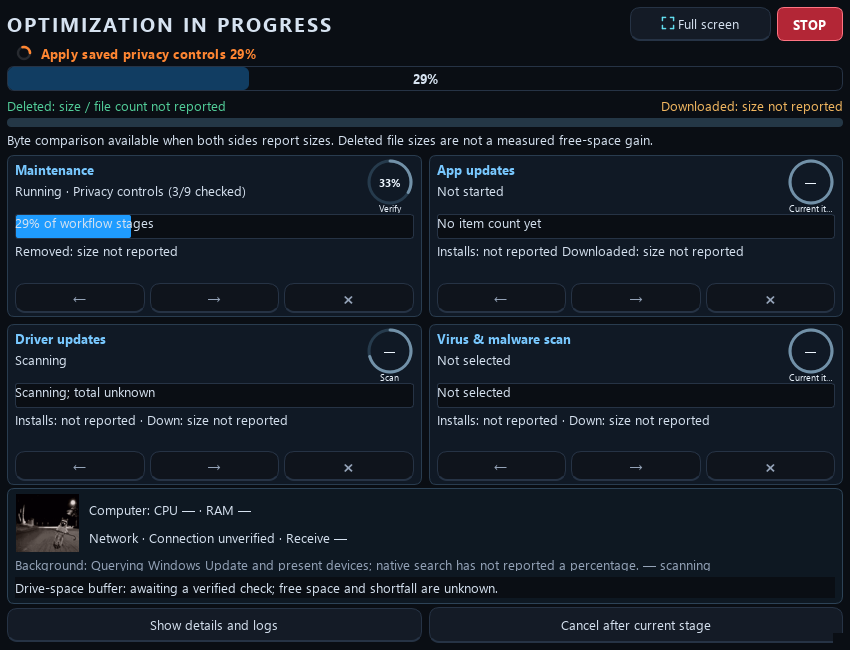

# Startup order and STOP

Optimus checks its own stable GitHub release before maintenance or background automation can begin. The interface can remain responsive during the check; responsiveness does not mean Auto Clean has started.

1. Establish the startup gate before queued interface and automation callbacks.
2. Check the official stable release. A supported newer release offers the existing update, continue-current-version or adjust-settings choices.
3. If approved, download and verify the update, complete its guarded restart and confirm the new window is ready. Maintenance remains paused throughout that handoff.
4. A verified single-use cleanup approval resumes the unchanged saved scope once. A restarted window without that valid approval stays paused for explicit review. Setup and saved-action consent still apply.

No newer release, an unavailable release check or an explicit decline can return to the current version's normal launch review. After accepting an update, a download, verification, preparation or handoff failure leaves maintenance paused for explicit review. Closing a question does not approve cleanup. Pressing STOP cancels the session instead of continuing a launch fallback.

## STOP and exit

The red **STOP** is available in the main window and progress headers. Its label, tooltip and accessible description identify the action as stopping Optimus and exiting. Worker arrows and item Cancel remain narrower controls for one item; STOP applies to the entire Optimus session.

Fixture preview of the STOP header and worker layout. These are simulated states, not a live host scan or measured cleanup result.

STOP first latches a session gate synchronously. Further maintenance starts, queued launch reviews, automatic fixes, recommendations and automatic cadence cannot dispatch new work. Repeated presses do not start another stop operation. Active questions are rejected without approving their choices, and supported worker cancellation is requested.

Cleanup can stop between protected file operations. Supported discovery/download clients can cancel at their checked boundaries. A system or vendor installer already applying changes may have no safe immediate cancellation mechanism. Optimus keeps an honest **finishing safely** status while outstanding native work and result observers are accounted for, then exits. A completed launcher is not treated as proof that its installer finished. Uncertain outcomes remain recorded; STOP does not erase their safety gates, retry them or fabricate success.

The action targets Optimus's work. It does not kill unrelated applications, arbitrary `msiexec` processes, Windows Update services or vendor processes merely because they exist. Windows Defender may continue scanning under Windows policy after Optimus stops its own supported client. Normal administrator approval and native package-manager authorization remain separate operating-system controls.

Existing Sandbox edits still use their unsaved-work guard before exit. Cancelling that guard keeps the stopped session open; it does not clear the STOP latch or resume maintenance. Saved settings, approvals, reports and recovery records are retained. Reopen Optimus when ready to begin a fresh reviewed session.

## Verification coverage

Disposable Qt fixtures cover Windows and native desktop windows, an early STOP before startup-controller creation, repeated requests, pending update checks, rejected setup/review questions, blocked Settings work and late worker-result callbacks. A simulated native observer verifies that alternate Close/Quit paths cannot bypass the drain gate. Responsive checks exercise the STOP label and hitbox on main and progress windows at compact and large sizes. These are interface and ordering tests; they do not install software or establish a computer-wide speed improvement.
